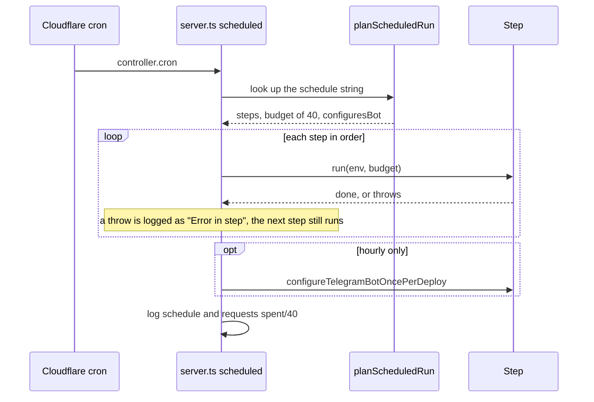
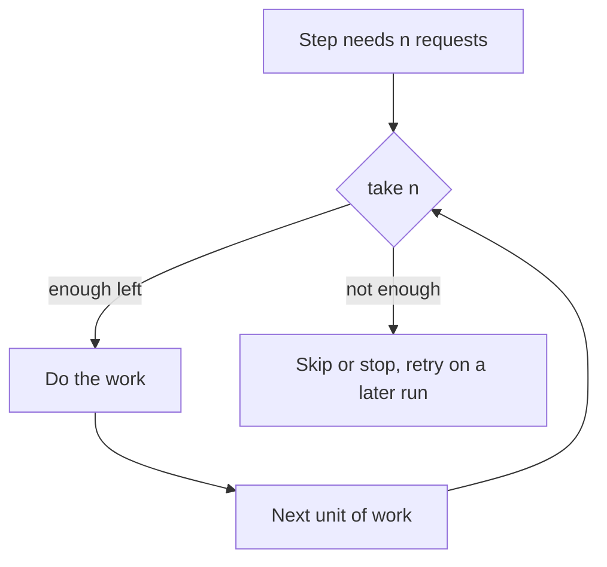

# Scheduled runs

How does a Cron Trigger turn into work, and how is the outside-request budget shared?

| Schedule | Steps | Detail |
| --- | --- | --- |
| `*/5 * * * *` | `cancelUnstartedBookings`, `updateOverdueBookings`, `sendBookingReminders` | [every-5-min.md](every-5-min.md) |
| `0 * * * *` | `checkFlamekeeperHealth`, `maintainPool`, `drainFlamekeepers`, `finishBans`, `deleteScheduledAlbums`, `checkBufferUsage`, then bot configuration | [hourly.md](hourly.md) |
| `0 3 * * *` | `graduateFlamekeepers` | [daily.md](daily.md) |

Each trigger is its own Worker invocation with its own budget of 40 outside requests (`RUN_SUBREQUEST_BUDGET`), under the Worker limit of 50. Calendar, Telegram, Drive, Google OAuth and email calls count. D1 queries do not.

How do steps spend the budget?

- `take(n)` is all or nothing. `takeUpTo(n)` grants what is left. `spend(n)` records without checking. `require(n)` throws `BudgetExhaustedError`. `sub(cap)` gives a step a slice of the pool (used by the health check).
- A step that runs out of budget does nothing that needs a request, so later steps may still do database-only work.
- The schedule strings in `src/lib/cron/schedule.ts` must match `crons` in `wrangler.jsonc`. An unknown string runs nothing and logs a warning.
- Work runs inside `ctx.waitUntil`. Steps are loaded with a dynamic import when their turn comes.
- Per-run caps (3 deletions, 3 ban cancellations, 3 graduation stops) apply per trigger run, so they are small on the daily trigger and larger per day on the hourly one.
- Test locally with `wrangler dev --test-scheduled` and `curl "http://localhost:3000/cdn-cgi/handler/scheduled?cron=0+*+*+*+*"`.
