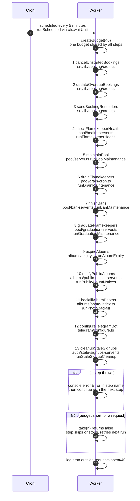

# The 5-minute cron run

> **Question:** What happens every 5 minutes when the clock trigger fires?
>
> **Answer:** The Worker runs 13 background steps one after another, always in the same order, sharing one budget of 40 outside requests (calendar, Telegram, Drive and similar calls). If a step throws, the error is logged and the next step still runs. If the budget runs out, steps that need more requests skip or stop their work and pick it up on a later run. At the end the Worker logs how much budget was used.
>
> **Notes:**
> - The schedule is `*/5 * * * *` in `wrangler.jsonc`. The work runs inside `ctx.waitUntil`, so it finishes after the trigger returns.
> - Steps run strictly in sequence, not in parallel. Each step file is loaded only when its turn comes.
> - Budget total is 40 (`RUN_SUBREQUEST_BUDGET`), under the Worker limit of 50 (`WORKER_SUBREQUEST_LIMIT`). Database queries are not counted, only outside requests.
> - Budget calls: `take(n)` is all or nothing and returns false when short. `takeUpTo(n)` grants what is left. `spend(n)` records a cost without checking. `require(n)` throws `BudgetExhaustedError`. `sub(cap)` hands a step a smaller slice of the same pool.
> - A thrown `BudgetExhaustedError` is handled like any other error: logged as `Error in <step>:` and the run moves on.
> - Later steps still run after the budget is empty. Each one checks its own costs, so most do nothing that needs an outside request.
> - Steps 1 to 3 are traced in `bookings/cancel-unstarted.md`, `bookings/mark-overdue.md` and `bookings/reminders.md`. Steps 4 to 8 are in `flamekeepers/`. Steps 9 to 13 are in `albums-and-housekeeping/`.

