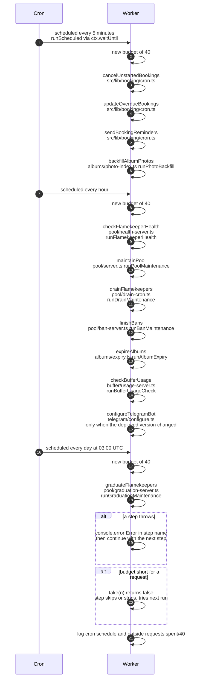

# The scheduled runs

> **Question:** What happens when a clock trigger fires?
>
> **Answer:** The Worker has three Cron Triggers: every 5 minutes, every hour and every day at 03:00 UTC. Each trigger runs its own list of background steps one after another, always in the same order, with its own budget of 40 outside requests (calendar, Telegram, Drive and similar calls). If a step fails, the error is logged and the next step still runs. When the budget runs out, a step that needs more requests skips or stops its work and picks it up on a later run. At the end the Worker logs the schedule and how much of its budget was used.
>
> **Notes:**
> - The schedules are `*/5 * * * *`, `0 * * * *` and `0 3 * * *` in `wrangler.jsonc`. The Worker reads which one fired from `controller.cron`, which is the exact string from the config, and looks up the steps in `src/lib/cron/schedule.ts`. A string it does not know runs nothing and logs a warning. The work runs inside `ctx.waitUntil`, so it can finish after the trigger itself has returned.
> - Steps run strictly in sequence, not in parallel. Each step file is loaded only when its turn comes.
> - Budget total is 40 (`RUN_SUBREQUEST_BUDGET`), under the Worker limit of 50 (`WORKER_SUBREQUEST_LIMIT`). Each trigger is a separate Worker invocation, so a run gets a fresh budget and one trigger can never use up another's. Database queries are not counted, only outside requests.
> - Budget calls: `take(n)` is all or nothing and returns false when short. `takeUpTo(n)` grants what is left. `spend(n)` records a cost without checking. `require(n)` throws `BudgetExhaustedError`. `sub(cap)` hands a step a smaller slice of the same pool.
> - A thrown `BudgetExhaustedError` is handled like any other error: logged as `Error in <step>:` and the run moves on.
> - Later steps still run after the budget is empty. Each one checks its own costs, so most do nothing that needs an outside request.
> - Every 5 minutes: `cancelUnstartedBookings`, `updateOverdueBookings`, `sendBookingReminders`, in `bookings/`. `backfillAlbumPhotos` also runs here until the photo table is removed, see `albums-and-housekeeping/photo-backfill.md`.
> - Every hour: `checkFlamekeeperHealth`, `maintainPool`, `drainFlamekeepers`, `finishBans` in `flamekeepers/` (start with `flamekeepers/steps-and-limits.md`), then `expireAlbums` (start with `albums-and-housekeeping/run-order.md`), then `checkBufferUsage` (`flamekeepers/buffer-usage.md`). After the steps, the Telegram bot is configured once per deploy, see `albums-and-housekeeping/bot-menu.md`.
> - Every day: `graduateFlamekeepers`, in `flamekeepers/graduation-trigger.md`.
> - Per-run caps inside a step (for example 3 ban cancellations or 3 graduation drains) apply per run, so on the hourly and daily schedules they now allow less work per day than on the old 5-minute schedule.

