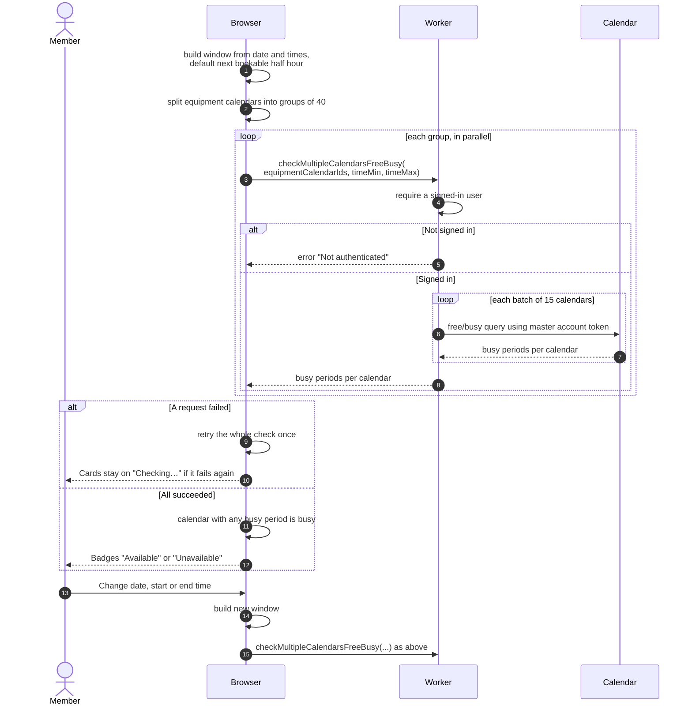

# Checking which equipment is free

> **Question:** How does the equipment list know which items are
> available for a chosen time?
>
> **Answer:** After the list loads, the browser asks the server which
> equipment calendars have an event in the chosen time window. The
> server answers from Google Calendar, using the club's master Google
> account. Equipment with at least one event in the window shows
> "Unavailable", the rest shows "Available". By default the window is
> the next bookable half hour. The member can change the date, start
> time and end time, which runs the check again. If the check fails,
> even after one automatic retry, the cards stay on "Checking…" and
> no error is shown.
>
> **Notes:**
> - The default window starts at the next half-hour mark that is at
>   least 60 minutes from now and inside operating hours. If none
>   fits today, it moves to the opening time of the next club day.
>   The end is 30 minutes after the start.
> - Availability comes only from Google Calendar events. A booking
>   that has no calendar event does not count. The code does not
>   filter events by type, so what Google counts as busy (for
>   example an event marked "free") is decided by Google.
> - The browser sends calendars in groups of at most 40, and the
>   server sends at most 15 per Google request. If any group fails,
>   the whole check fails.
> - If Google reports a problem with one calendar, the code ignores
>   it and treats that calendar as free.
> - Items already in the booking being edited show "In booking".
> - Changing only the date or times reuses the loaded list.
> - The date button shows today's date until the member picks one.
>   If the default window has moved to the next club day, the check
>   runs for that day while the button still shows today.
> - In add-to-booking mode the window is the booking's own time and
>   the date and time filters are hidden, see `select-and-book.md`.

