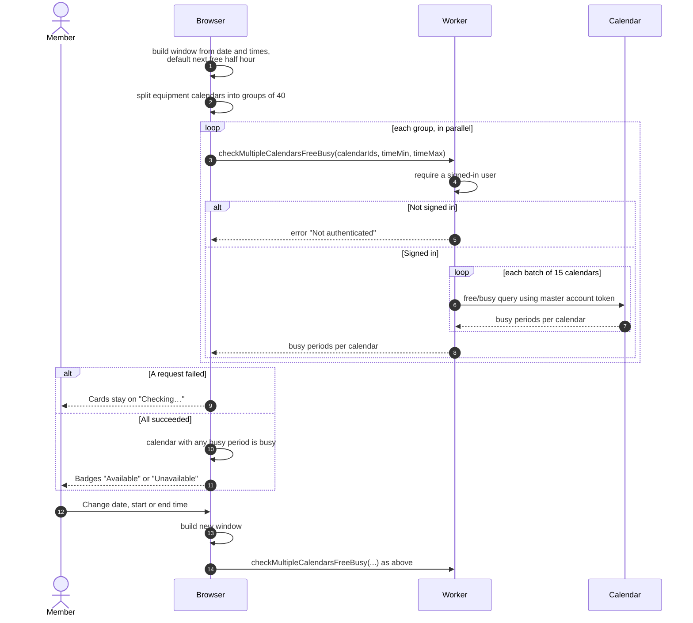

# Checking which equipment is free

> **Question:** How does the equipment list know which items are
> available for a chosen time?
>
> **Answer:** After the list loads, the browser asks the server which
> equipment calendars have any event inside the time window, using the
> club's master Google account. Equipment with at least one event in the
> window is shown as "Unavailable", the rest as "Available". By default
> the window is the next free half hour. The member can change the date,
> start time and end time, which re-runs the check. If the check fails the
> cards stay on "Checking…" and no error is shown.
>
> **Notes:**
> - The default window starts at the next half-hour mark that is at least
>   60 minutes from now and inside operating hours. If none fits today, it
>   moves to the first half hour of the next club day. The end is 30
>   minutes later.
> - Availability comes only from Google Calendar events. Bookings that
>   are not in the calendar do not count.
> - The browser sends calendars in groups of at most 40, and the server
>   sends at most 15 per Google request.
> - Inactive equipment shows "Unavailable" without waiting for the
>   check. Items already in the booking being edited show "In booking".
> - Changing only the date or times reuses the loaded list.
> - In add-to-booking mode the window is the booking's own time and the
>   date and time filters are hidden, see `select-and-book.md`.

