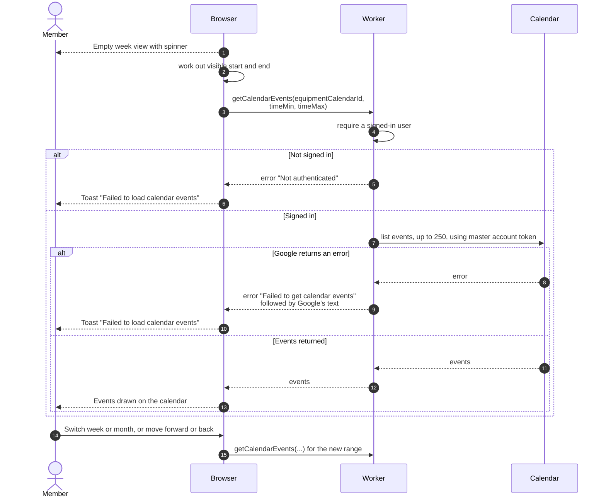

# Equipment calendar view

> **Question:** How does the calendar on the equipment detail page get
> its events?
>
> **Answer:** The calendar opens on a week view, with a month view
> available, and cannot be edited. Whenever the visible range
> changes, the browser asks the server for the events of that item's
> Google calendar in that range and draws them. If loading fails the
> member sees the toast "Failed to load calendar events".
>
> **Notes:**
> - The server reads the calendar with the club's master Google
>   account, for any signed-in user. At most 250 events are returned
>   per request, ordered by start time, with repeating events
>   split into single events. Events beyond 250 are not shown.
> - A spinner shows only while loading and nothing is drawn yet.
> - A legend under the calendar names the item.
> - If the range changes while a request is running, the older
>   answer is dropped.
> - Cancelled events are not drawn. All-day events are drawn as
>   all-day. An event with no title shows "(no title)".
> - The same toast appears whatever the cause. The browser only logs
>   the server's error text.

