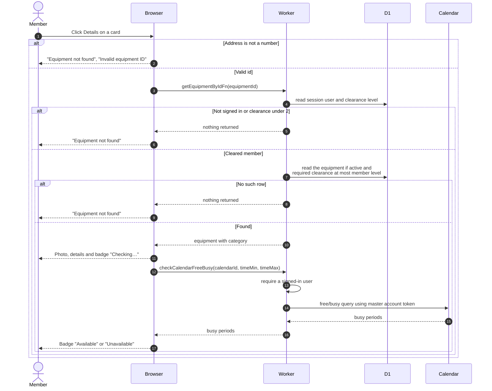

# Viewing one piece of equipment

> **Question:** What does a member see on an equipment detail page?
>
> **Answer:** The page shows the photo, description, category, required
> clearance level and an availability badge for the next free half hour,
> followed by a calendar of the item's events. If the item is missing,
> inactive, above the member's clearance, or the address is not a number,
> the member sees "Equipment not found" with a matching explanation.
>
> **Notes:**
> - The page has no booking button. The member goes back to the list to
>   select it, see `select-and-book.md`.
> - The badge uses the same window rule as the list cards, see
>   `check-availability.md`. Unlike the cards, a failed check shows
>   "Unavailable". Inactive equipment is "Unavailable" without a check.
> - The explanations are "Invalid equipment ID" for a bad address and
>   "The equipment you're looking for doesn't exist or you don't have
>   access to it." otherwise.
> - A member under clearance 2 gets nothing back and so sees the same
>   not-found message.
> - The calendar is described in `equipment-calendar.md`. The photo is
>   described in `equipment-images.md`.

