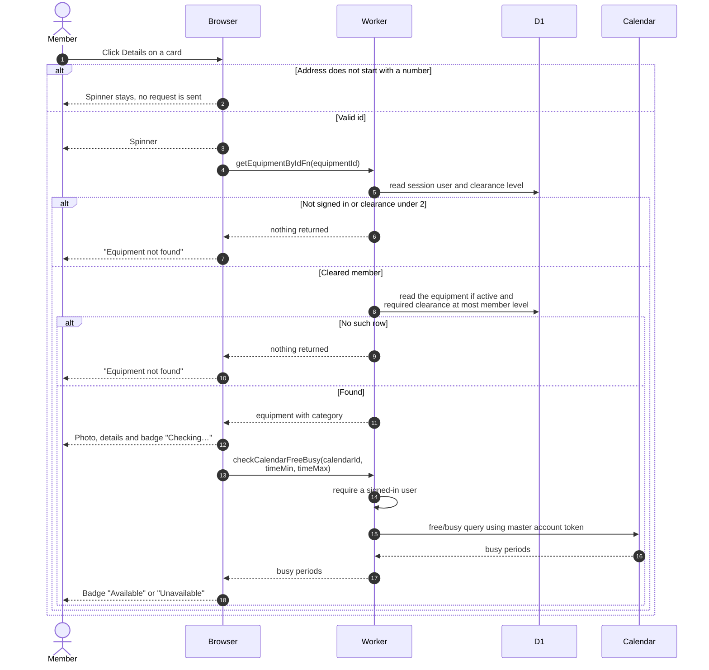

# Viewing one piece of equipment

> **Question:** What does a member see on an equipment detail page?
>
> **Answer:** The page shows the photo, description, category,
> required clearance level and an availability badge for the next
> bookable half hour, followed by a calendar of the item's events.
> If the item is missing, inactive, or above the member's clearance,
> the member sees "Equipment not found" with an explanation. If the
> address after `/equipment/` does not start with a number, the page
> shows a spinner and never reaches a message.
>
> **Notes:**
> - The page has no booking button. The member goes back to the list
>   to select the item, see `select-and-book.md`.
> - The badge uses the same window rule as the list cards, see
>   `check-availability.md`. Unlike the cards, a failed check shows
>   "Unavailable". Inactive equipment never reaches the page, so the
>   badge only ever reflects the calendar.
> - The explanation is "The equipment you're looking for doesn't
>   exist or you don't have access to it." The page also holds the
>   text "Invalid equipment ID" for a non-numeric address, but the
>   spinner is returned first, so that text is never shown.
> - A number followed by letters, such as `12abc`, is read as 12.
> - A member under clearance 2 gets nothing back and so sees the
>   same not-found message.
> - If the item is not found, the browser may retry the request once
>   before showing the message. The code does not settle this.
> - The page also has a back button in its header. It goes back in
>   history, or to the equipment list when there is no history.
> - The calendar is described in `equipment-calendar.md`. The photo
>   is described in `equipment-images.md`.

