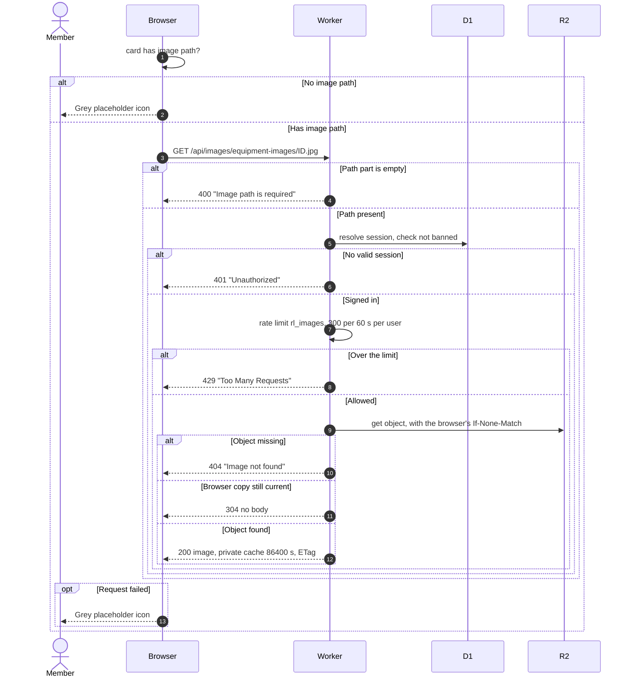

# How equipment photos are shown

> **Question:** How does an equipment photo get from storage to the
> screen?
>
> **Answer:** Cards and the detail page ask the Worker for
> `/api/images/` followed by the stored image path. The Worker checks the
> user is signed in and under the image rate limit of 300 per minute, then
> reads the file from the R2 bucket and sends it with a one-day private
> cache. If the file cannot be shown, the page shows a grey placeholder
> icon instead. Only equipment photos are served this way.
>
> **Notes:**
> - Returned statuses are 400 "Image path is required", 401
>   "Unauthorized", 429 "Too Many Requests", 404 "Image not found", 500
>   "Storage not configured" and 500 "Internal server error".
> - When the browser asks again with its saved ETag, R2 compares it
>   itself and the Worker answers 304 with no body.
> - The route reads any path in the bucket for any signed-in user, not
>   only equipment images. Bans count as signed out.
> - Album photos do not use this route. They load from Google's image
>   servers by Drive file id, see the `albums/` folder.
> - Equipment with no image path shows the placeholder without a request.
>   The upload of images is an admin action, see the `admin/` folder.
> - The rate limit is counted per user, and if the limiter fails the
>   request is let through.

