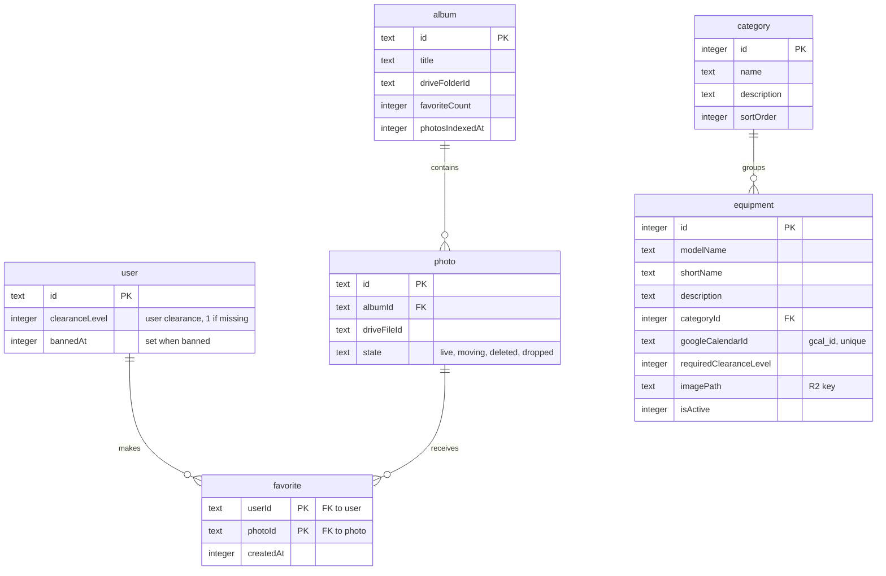

# Equipment data model

> **Question:** Which tables and stored data do the equipment and
> favorites scenarios use?
>
> **Answer:** Browsing reads equipment and category rows, filtered by the
> member's clearance level on the user row. Favorites read and write
> favorite rows and the favorite count on the album, and may add photo
> rows. Equipment images live in R2, and no KV data is used.
>
> **Notes:**
> - R2 bucket binding `meriksirat_r2`: key pattern
>   `equipment-images/{equipmentId}-{timestamp}.{ext}` as written by the
>   admin upload, with no expiry. The column comment in the schema shows
>   an older pattern `equipment-images/{id}.jpg`.
> - KV is not used. The rate limiter for images is a Cloudflare rate
>   limit binding with 300 requests per 60 seconds, not stored data.
> - Google free/busy and event data is read live from Google Calendar and
>   is not stored in D1.
> - The Google calendar id of each equipment is unique.

