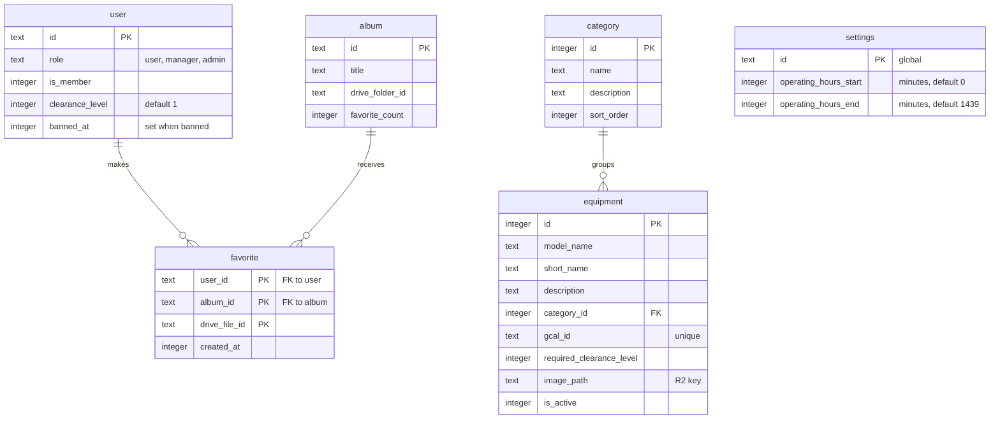

# Equipment data model

> **Question:** Which tables and stored data do the equipment and
> favorites scenarios use?
>
> **Answer:** Browsing reads equipment and category rows, limited by
> the member's clearance level on the user row, plus the operating
> hours in the settings row. Favorites read and write favorite rows
> and the favorite count on the album.
> Equipment images live in R2. No KV data is used.
>
> **Notes:**
> - R2 bucket binding `meriksirat_r2`: key pattern
>   `equipment-images/{equipmentId}-{timestamp}.{ext}` as written by
>   the admin upload, with no expiry. The comment in the schema
>   shows an older pattern, `equipment-images/{id}.jpg`.
> - KV is not used. The image rate limit is a Cloudflare rate limit
>   binding of 300 requests per 60 seconds, not stored data.
> - Google free/busy and event data is read live from Google
>   Calendar and is not stored in D1.
> - The Google calendar id of each equipment (`gcal_id`) is unique.
> - A missing or zero clearance level counts as 1. The settings row
>   with id `global` is created with defaults when it is missing.
> - The sidebar also reads role and is_member from the user row.

