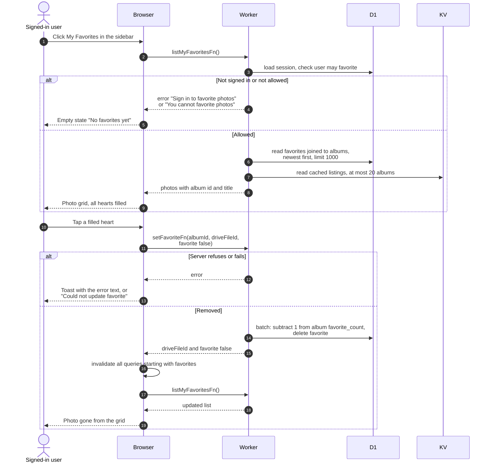

# My favorites page

> **Question:** What does the My Favorites page show, and how does a
> user remove a photo from it?
>
> **Answer:** It lists the photos the user has hearted in any
> album, newest favorite first, up to 1000. With none, it says "No
> favorites yet" and "Tap the heart on a photo in any album to save
> it here." Tapping a filled heart asks the server to remove the
> favorite. When the server confirms, the list reloads and the photo
> disappears.
>
> **Notes:**
> - Available to members and non-members alike. A user who is not
>   signed in is sent to the login page first.
> - Unlike the album page, nothing changes on screen until the
>   server has answered. The heart stays filled until then.
> - Names and dates come from the albums' cached Drive listings in KV,
>   read for at most 20 albums per visit and never refreshed from
>   Drive here, so the page makes no Drive calls. A photo whose album
>   listing is not cached, or is incomplete, still shows with the name
>   "Photo" and its image. A photo missing from a complete listing is
>   left out, without an error.
> - Removing uses the same save step as `toggle-favorite.md`, so the
>   album's favorite count also drops by one.
> - If loading fails, the error is only logged and the page shows
>   its empty state. A grey block shows while loading.
> - The list is never reused from an earlier visit (stale time 0),
>   so each visit asks the server again.
> - The server also refuses users who may not favorite, but every
>   signed-in user may, so that refusal is not seen in practice.

