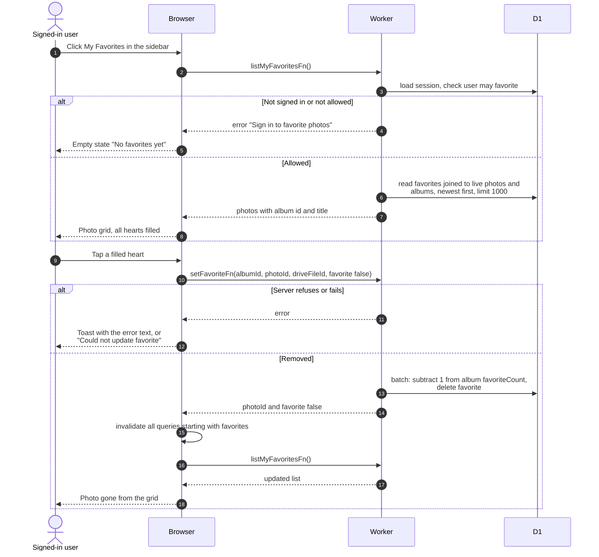

# My favorites page

> **Question:** What does the My Favorites page show, and how does a
> user remove a photo from it?
>
> **Answer:** It lists the photos the user has hearted in any album, newest
> favorite first, up to 1000, and only photos that are still live. With
> none, it says "No favorites yet" and "Tap the heart on a photo in any
> album to save it here." Tapping the filled heart removes the photo after
> the server confirms, then the list reloads.
>
> **Notes:**
> - Available to members and non-members alike. Not signed in users are
>   sent to login first.
> - Unlike the album page, nothing is changed on screen until the server
>   has answered.
> - Removing uses the same save step as `toggle-favorite.md`, so the
>   album's favorite count also drops by one.
> - If loading fails the error is only logged and the page shows its
>   empty state. A skeleton shows while loading.
> - The list is never cached beyond the moment (stale time 0), so each
>   visit reloads it.

