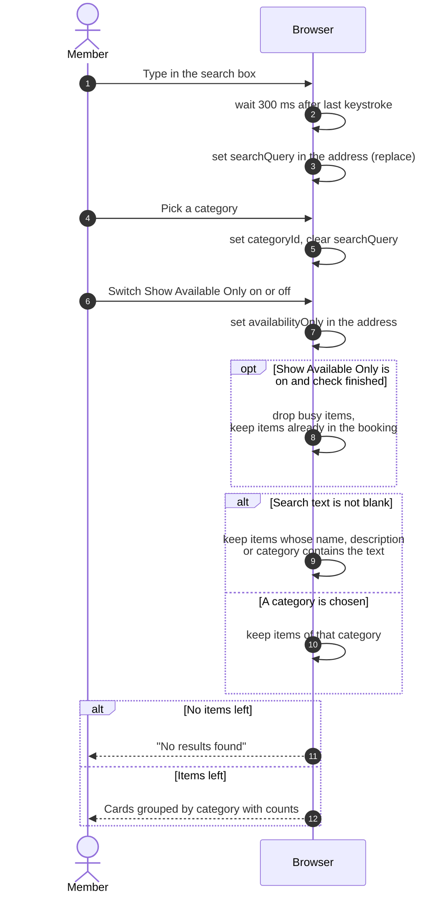

# Searching and filtering equipment

> **Question:** How do search, category and "Show Available Only"
> narrow the equipment list?
>
> **Answer:** All narrowing happens in the browser on the list that
> was already loaded, so nothing is sent to the server when the
> member types or picks a category. Search waits 300 ms after typing
> stops and puts the text in the page address. Picking a category
> puts its id in the address and clears any search text. When both
> are present, search wins and the category is ignored. With "Show
> Available Only" on, busy equipment is hidden once the availability
> check has finished.
>
> **Notes:**
> - Search is case-insensitive and matches the model name, the
>   description and the category name. It ignores leading and
>   trailing spaces.
> - Items already in the booking being edited stay visible under
>   "Show Available Only", so the member can see they are included.
> - Sidebar and dropdown category counts cover the whole loaded
>   list. The number beside each group heading counts only the
>   items left after filtering. On phones the category list is a
>   dropdown.
> - "All Equipment" clears both the category and the search text.
> - With no match, the page shows "No results found" and a hint to
>   adjust filters. With nothing loaded and no filter it shows "No
>   equipment available". Choosing a date or time counts as a
>   filter for this message.
> - The list holds only active equipment, so there is no inactive
>   item to hide.
> - Date and time filters change the availability window, see
>   `check-availability.md`.
> - The filters live in the address, so reloading or sharing the
>   link keeps them. Search updates replace the history entry,
>   category picks add a new one.

