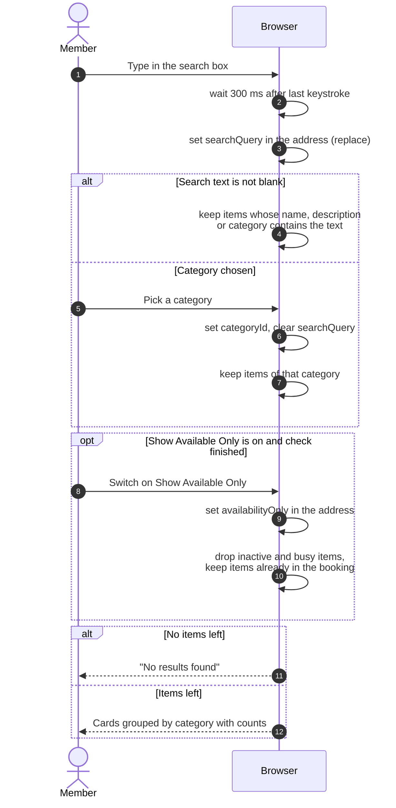

# Searching and filtering equipment

> **Question:** How do search, category and "Show Available Only"
> narrow the equipment list?
>
> **Answer:** All narrowing happens in the browser on the list that was
> already loaded, so nothing is sent to the server when the member types
> or picks a category. Search waits 300 ms after typing stops and puts the
> text in the page address. Picking a category puts its id in the address
> and clears any search text. Search takes priority over category when
> both are present. With "Show Available Only" on, busy and inactive
> equipment is hidden once the availability check has finished.
>
> **Notes:**
> - Search is case-insensitive and matches the model name, the
>   description and the category name.
> - Items already in the booking being edited stay visible under
>   "Show Available Only", so the member can see they are included.
> - Category counts in the sidebar and dropdown count the whole loaded
>   list, not the filtered one. On phones the category list is a dropdown.
> - With no match, the page shows "No results found" and a hint to adjust
>   filters. With nothing loaded and no filter it shows "No equipment
>   available".
> - Date and time filters change the availability window, see
>   `check-availability.md`.
> - The filters live in the address, so reloading or sharing the link
>   keeps them.

