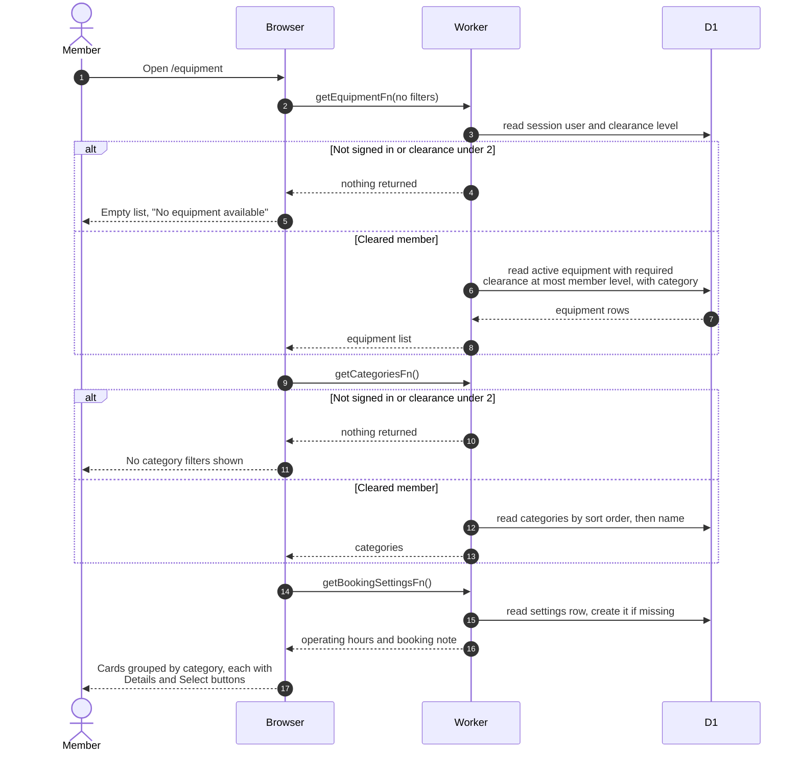

# Opening the equipment list

> **Question:** What happens when a member opens the equipment page,
> and what do members with low clearance see?
>
> **Answer:** The page loads the list of active equipment the member
> is cleared for, the categories and the booking settings, then shows
> equipment cards grouped by category. A member whose clearance is
> below 2, or whose session is missing, gets no equipment and no
> categories, so the page shows "No equipment available". The page is
> not blocked for them. Only the sidebar link is greyed out.
>
> **Notes:**
> - Equipment is listed only if it is active and its required
>   clearance level is at most the member's own level. A member with
>   no stored level counts as level 1.
> - The list is fetched once with no filters. Search, category and
>   availability filtering happen in the browser, see
>   `filter-and-search.md`.
> - The list is reused for 60 seconds and the booking settings for 5
>   minutes. The settings give the operating hours, so the default
>   time window is right on the first draw. If the settings row does
>   not exist, the server creates it with hours 0 to 1439.
> - In add-to-booking mode the page also loads the booking's time
>   window and its equipment ids, see `select-and-book.md`.
> - If the loader fails, the error is only logged and the page shows
>   whatever the queries hold, which is empty data at first.
> - Availability badges are filled in by `check-availability.md`.
> - Non-members never get here, see `sidebar-access.md`.

