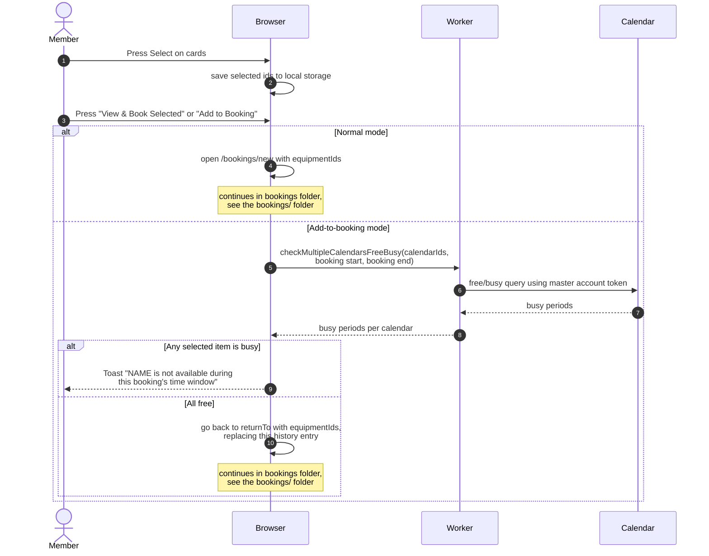

# Selecting equipment and moving on to a booking

> **Question:** How does a member pick equipment on the list and start
> a booking, or add more items to an existing booking?
>
> **Answer:** The member presses Select on one or more available cards,
> then presses "View & Book Selected", which opens the new-booking page
> with those items. Creating the booking itself is covered in the
> bookings folder. When the member came from an existing booking through
> "Add More", the button reads "Add to Booking". Before returning, the
> page checks the chosen items against that booking's time window and
> refuses if any item is busy.
>
> **Notes:**
> - The selection is remembered in the browser's local storage under
>   `equipment-selection`, so it survives reloads. Arriving in
>   add-to-booking mode clears it first.
> - Inactive items and items already in the booking cannot be selected.
> - In add-to-booking mode the Back button returns to the booking and the
>   header shows "Adding to booking" with its id and the window.
> - The new-booking page and adding items to an existing booking
>   continue in the `bookings/` folder.
> - Add-to-booking mode without a return address falls back to opening
>   the new-booking page.
> - The toast says "are" instead of "is" when several items conflict.
> - "Clear selection" appears when at least one item is selected.

