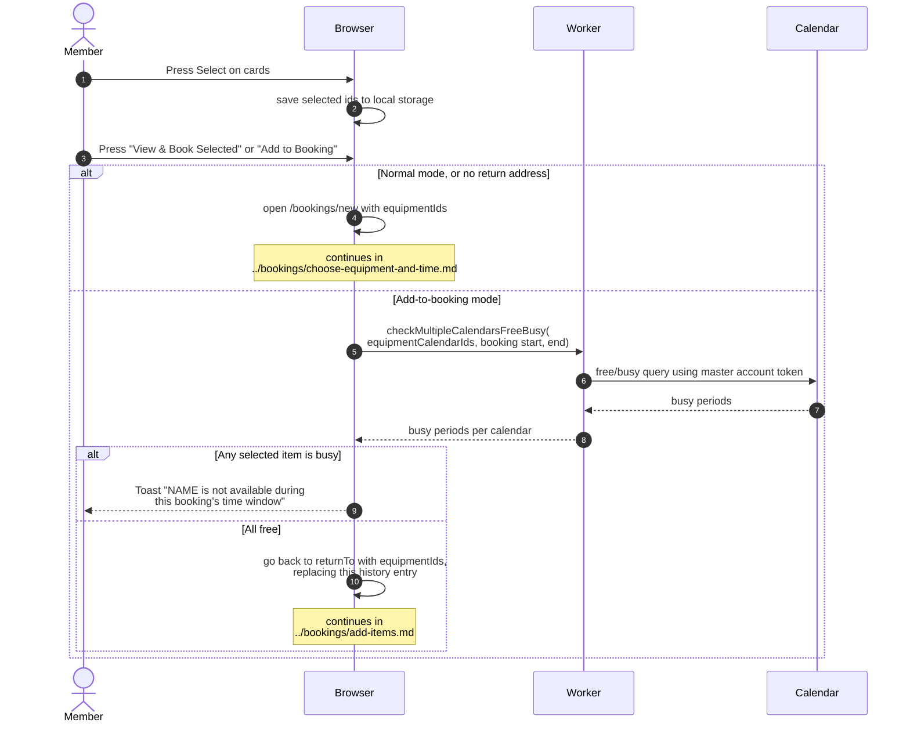

# Selecting equipment and moving on to a booking

> **Question:** How does a member pick equipment on the list and
> start a booking, or add more items to an existing booking?
>
> **Answer:** The member presses Select on one or more cards, then
> presses "View & Book Selected", which opens the new-booking page
> with those items. Creating the booking is covered in
> `../bookings/create-booking.md`. When the member came from an
> existing booking through "Add More", the button reads "Add to
> Booking". Before returning, the page checks the chosen items
> against that booking's time window and refuses if any item is busy.
>
> **Notes:**
> - The selection is remembered in the browser's local storage under
>   `equipment-selection`, so it survives reloads. Arriving in
>   add-to-booking mode clears it first.
> - In normal mode a card with an "Unavailable" badge can still be
>   selected. Only items already in the booking cannot be selected.
> - The check in add-to-booking mode runs again for the whole list
>   in groups of 40, not only for the chosen items. If that run
>   fails and an earlier answer exists, the earlier answer is used.
>   If none exists, every item counts as free. No error is shown.
> - In add-to-booking mode the Back button returns to the booking
>   and the header shows "Adding to booking #" with the booking id
>   and the time window.
> - The new-booking page continues in
>   `../bookings/choose-equipment-and-time.md`. Adding the items to
>   the booking continues in `../bookings/add-items.md`.
> - Add-to-booking mode without a return address opens the
>   new-booking page like normal mode.
> - The toast says "are" instead of "is" when several items conflict.
> - "Clear selection" appears when at least one item is selected.
>   The button is disabled while nothing is selected.

