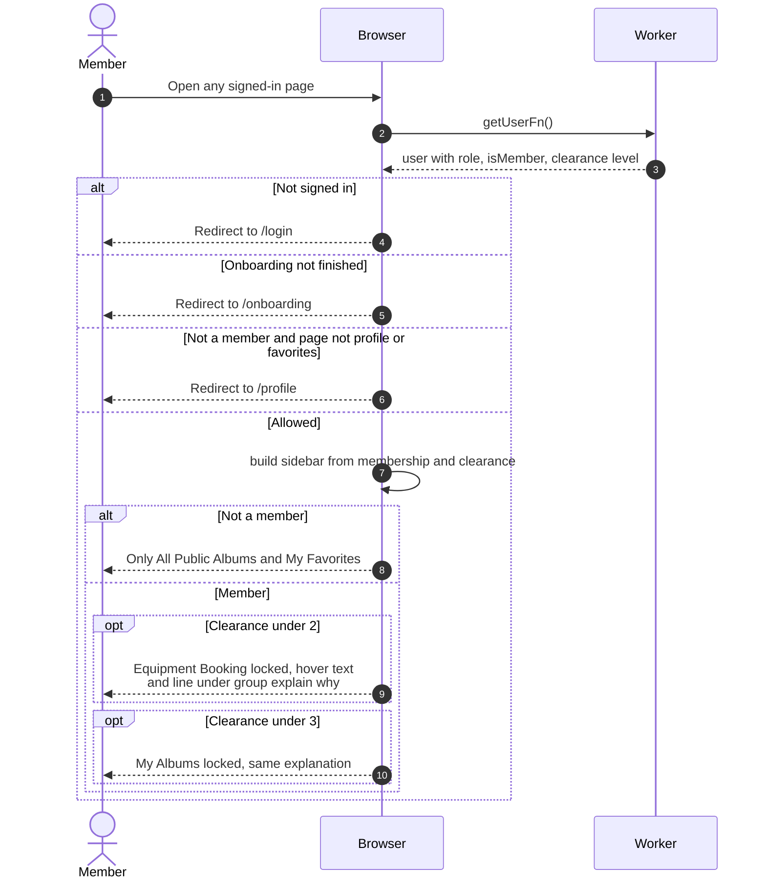

# Sidebar links that are locked

> **Question:** Which sidebar entries are disabled, and for whom?
>
> **Answer:** After sign-in the sidebar is built in the browser from the
> member's role, membership flag and clearance level. "Equipment Booking"
> is greyed out with a lock for clearance under 2, and "My Albums" for
> clearance under 3. A hover text and a line under the group explain what
> is needed. Non-members see only "All Public Albums" and "My Favorites",
> and are sent to the profile page if they try any other address.
>
> **Notes:**
> - Locked entries cannot be clicked, but the pages are not blocked by
>   address. A member under clearance 2 who opens `/equipment` directly
>   gets the empty list in `load-equipment-page.md`.
> - Texts are "Equipment booking requires clearance level 2 or higher.
>   Contact an admin to request access." and "Album creation and
>   management require clearance level 3. Contact an admin to request
>   access."
> - "My Bookings" and "My Favorites" are never locked for members.
> - Admin links appear for roles admin and manager only.
> - Allowed non-member pages are the profile and favorites pages.

