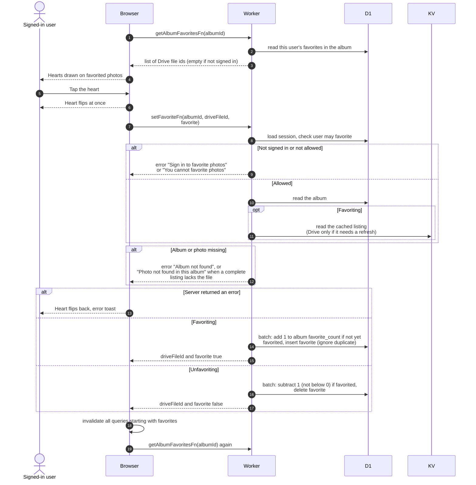

# Favoriting a photo

> **Question:** What happens when a signed-in user taps the heart on
> a photo in an album?
>
> **Answer:** The heart fills or empties at once, and the change is
> saved in the background. If saving fails, the heart goes back and
> the user sees a toast with the error text. Either way, all
> favorites data is then reloaded. Saving adds or removes the user's
> favorite for that photo and moves the album's favorite count up or
> down by one.
>
> **Notes:**
> - The heart appears only for signed-in users. A filled heart is
>   always visible. An empty one on the grid is hidden until hover on
>   large screens and always visible on phones. The enlarged photo
>   view uses the same control.
> - The list of hearted photos in an album is loaded once per album
>   and reused for 30 seconds. It holds Drive file ids, and is empty
>   for a user who is not signed in.
> - A favorite is stored as user, album and Drive file id, so any
>   listed photo can be favorited, including an upload with no photo
>   row. When favoriting, the file is checked against the album's
>   cached Drive listing. Only a complete listing that lacks the file
>   gives "Photo not found in this album". Unfavoriting never checks.
> - When a photo moves to a new Drive file, a shared remap re-points
>   favorites and the album cover. See ADR-0017.
> - The count goes up only if the user had not already favorited
>   the photo, and down only if they had, so repeated taps do not
>   drift the count. It never goes below 0.
> - The toast shows the text of whatever error the server raised.
>   Examples are "Sign in to favorite photos", "You cannot favorite
>   photos", "Album not found", "Photo not found in this album",
>   or an error text from Drive. "Could not update favorite" shows only when the
>   error has no text of its own.
> - The favorites page is described in `favorites-page.md`.
> - Loading an album page is described in `../albums/view-album.md`.

