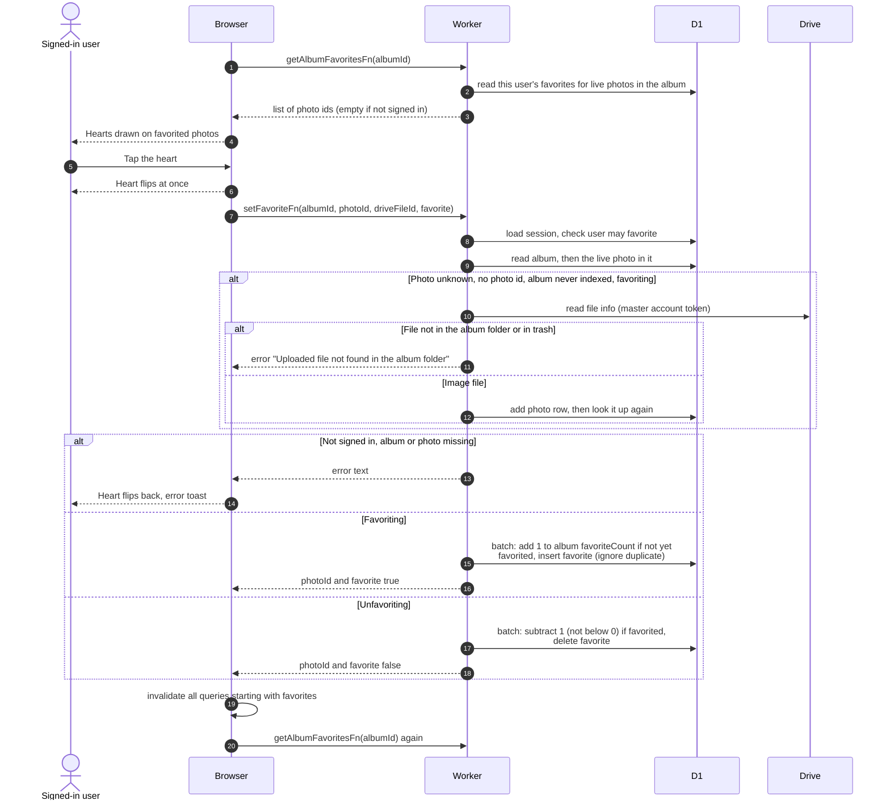

# Favoriting a photo

> **Question:** What happens when a signed-in user taps the heart on a
> photo in an album?
>
> **Answer:** The heart fills or empties at once, and the change is saved
> in the background. If saving fails the heart goes back and the user sees
> a toast with the error text. Afterwards all favorites data is reloaded.
> Saving adds or removes the user's favorite for that photo and moves the
> album's favorite count up or down by one.
>
> **Notes:**
> - The heart appears only for signed-in users. On the grid it is hidden
>   until hover on large screens and always visible on phones. The
>   enlarged photo view uses the same control.
> - The set of hearted photos in an album is loaded once per album and
>   kept for 30 seconds. It lists only live photos.
> - Photos not yet in the database are looked up in the album's Drive
>   folder with the master account and added, but only when favoriting,
>   only when the album has never been fully indexed, and only when the
>   page did not send a photo id.
> - Counts change only if the favorite did not already exist (or does),
>   so repeated taps do not drift the count. The count never goes below 0.
> - Error texts include "Sign in to favorite photos", "You cannot
>   favorite photos", "Album not found", "Photo not found in this album"
>   and "Uploaded file not found in the album folder". Anything else shows
>   "Could not update favorite".
> - The favorites page is described in `favorites-page.md`.

