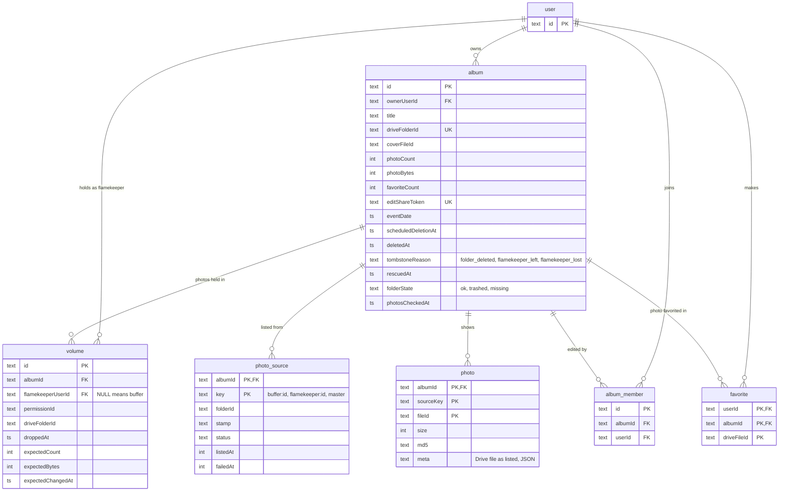

# ERD: albums and storage

Which tables hold albums, who holds their photos, and who can edit or favorite them? Source: `src/db/schema.ts`. Statuses are derived, not stored ([ADR-0018](../../adr/0018-album-status-is-derived-with-six-statuses.md)).

- A volume holds at most 256 MB. Rows with no `flamekeeperUserId` are the buffer's; flamekeeper rows are created by an offload and carry `expected*` like the buffer's (legacy flamekeeper rows keep them NULL).
- A row with `droppedAt` set is not live: it is skipped by listings and the storage holder, and the cleanup of dropped volumes deletes what its folder still holds, then the row. Offloads and rescues stage their new volumes as dropped rows and make them live in one batch ([album-offload](../kv/album-offload.md)).
- `volume.flamekeeperUserId` points at `user`, not at the `flamekeeper` table.
- `album_member` is unique on `(albumId, userId)`: a user who opens the edit link becomes a co-author.
- `favorite` stores a Drive file id. A photo's identity is still its current Drive file id, so when a file moves to another account, favorites are remapped and the album's `photo` rows are rebuilt from Drive.
- `photo` and `photo_source` are what album pages read; uploads, deletes and listings of Drive keep them current ([album-listing](../kv/album-listing.md)). `photoCount` and `photoBytes` are totals synced from a complete listing.
- `album` is indexed on `(createdAt, id)`, the order the album lists page through, so a page reads about as many rows as it shows.
- Deleting an album cascades to volumes, members, favorites, photo sources and photos.
