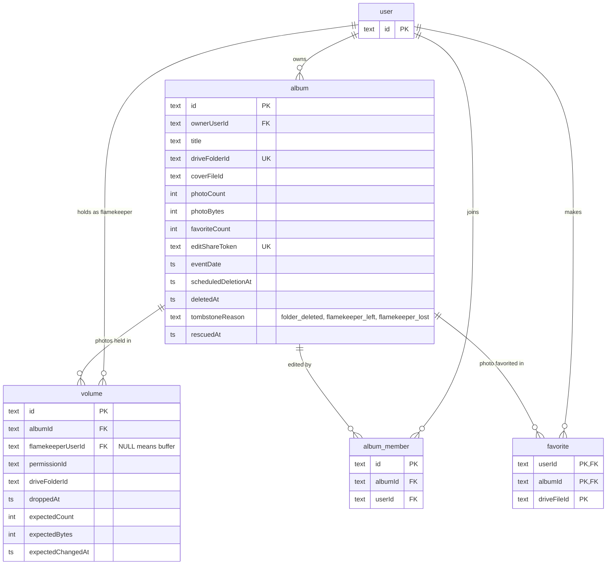

# ERD: albums and storage

Which tables hold albums, who holds their photos, and who can edit or favorite them? Source: `src/db/schema.ts`. Statuses are derived, not stored ([ADR-0018](../../adr/0018-album-status-is-derived-with-six-statuses.md)).

- A volume holds at most 256 MB. Rows with no `flamekeeperUserId` are the buffer's; flamekeeper rows appear only after an offload (or on legacy data) and keep `expected*` NULL.
- `volume.flamekeeperUserId` points at `user`, not at the `flamekeeper` table.
- `album_member` is unique on `(albumId, userId)`: a user who opens the edit link becomes a co-author.
- `favorite` stores a Drive file id, not a photo row; photos exist only in Drive. When a file moves to another account, favorites are remapped.
- `photoCount` and `photoBytes` are totals synced from the listing cache ([album-listing](../kv/album-listing.md)).
- Deleting an album cascades to volumes, members and favorites.
