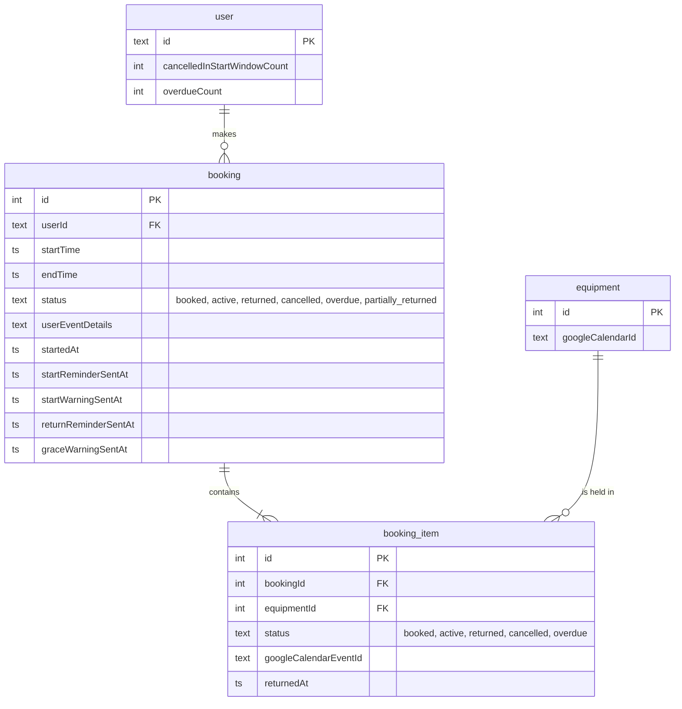

# ERD: bookings

Which tables hold bookings and their items? Source: `src/db/schema.ts`.

- A booking's status is derived from its items and never set directly; `partially_returned` exists only on the booking ([GLOSSARY.md](../../../GLOSSARY.md)).
- Each item has one calendar event on its equipment's calendar.
- The four `*SentAt` columns make reminders idempotent ([every-5-min.md](../cron/every-5-min.md)).
- The two user counters are bumped once per booking by the auto-cancel and overdue steps.
- Deleting a booking cascades to its items.
