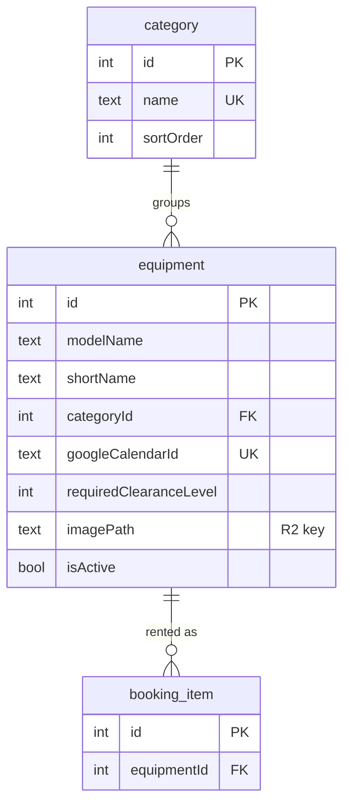

# ERD: equipment

Which tables describe the equipment catalog? Source: `src/db/schema.ts`. Rentals of it are in [bookings.md](bookings.md).

- Each piece of equipment has its own Google calendar (`gcal_id`).
- `imagePath` is a single R2 key such as `equipment-images/{id}.jpg`.
- `requiredClearanceLevel` is a catalog attribute used for filtering; booking code does not compare it with `user.clearanceLevel`.
