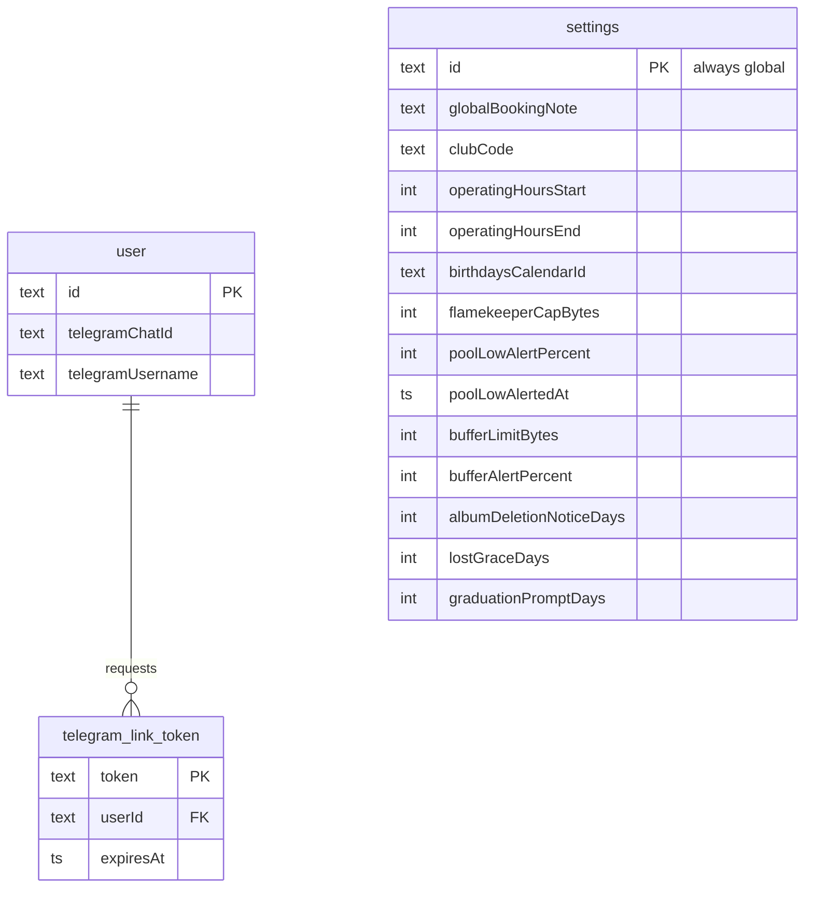

# ERD: Telegram and settings

Where do Telegram links and club-wide settings live? Source: `src/db/schema.ts`.

- Linking is one-shot: the link token is exchanged for `telegramChatId` and `telegramUsername` on the user. Bot conversation state is in the `app_state` table ([telegram-session](../state/telegram-session.md)).
- `settings` has a single row, `id = 'global'`. Cron reads the pool and buffer values ([hourly.md](../cron/hourly.md)).
- `poolLowAlertedAt` is the "already alerted" marker for the pool-low alert.
- `lostGraceDays` and `graduationPromptDays` are read by the cron steps and the pledge/graduation changes (defaults 7 and 60 days).
- `settings` has no foreign keys.
