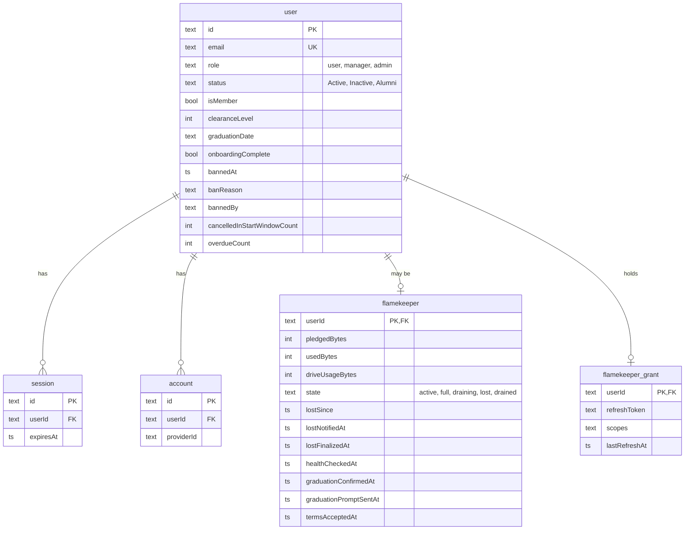

# ERD: users and flamekeepers

Which tables hold accounts, sessions and flamekeepers? Source: `src/db/schema.ts`. Terms: [GLOSSARY.md](../../../GLOSSARY.md).

- `flamekeeper.state` `drained` is shown as Stopped. Banned is not a state; it is `user.bannedAt` and overrides the shown status.
- Member status (`user.status`) is separate from flamekeeper state and from a ban ([ADR-0020](../../adr/0020-member-status-separate-from-flamekeeper-state-and-ban.md)).
- Deleting a user cascades to sessions, accounts, flamekeeper and grant.
- The grant (Drive refresh token) is dropped when flamekeeping ends. The `verification` table (auth tokens) is omitted.
