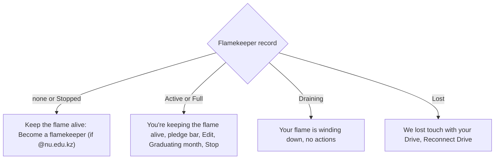
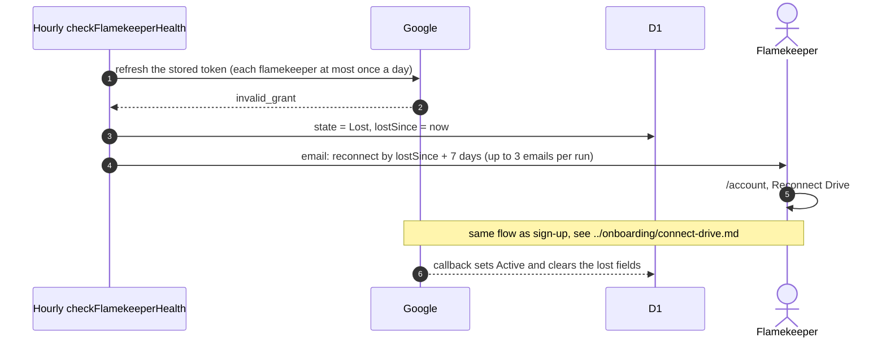

# Flamekeeper card on the account page

The Flamekeeper section of `/account` shows the person's state and pledge. The state is system-managed ([GLOSSARY](../../../../GLOSSARY.md), Flamekeeper). "Used" is what admins have offloaded to them; it is 0 until an offload.

## What does the card show in each state?

- Edit pledge and Stop are offered only while Active or Full ([change-pledge.md](change-pledge.md), [stop.md](stop.md)). Full is reset to Active by the hourly `maintainPool` step.
- Draining is only found on rows left by the old drain code; the hourly `drainFlamekeepers` step ends them.
- The Graduating month field shows for flamekeepers who are not members. Members edit it in their profile.
- A yearly "Still graduating in ...?" prompt appears when the date is due ([graduation.md](graduation.md)).

## How does a flamekeeper become Lost and recover?

Other failures (network, Google outage) are retried an hour later and never mark Lost. A successful check also stores Drive usage and syncs a changed Google email to the account. The grace period is the Settings value `lostGraceDays` (default 7) ([settings/other-settings.md](../../admin/settings/other-settings.md)). Cron overview: [cron](../../cron/).
