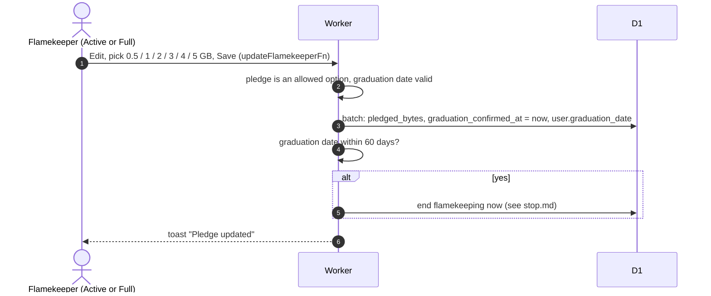

# Change pledge

## How does a flamekeeper change their pledge?

- The dialog resubmits the profile's graduation month; if none is set it asks for one first.
- A Stopped flamekeeper cannot edit ("Sign up again to resume flamekeeping").
- Changing the pledge counts as a graduation confirmation. A pledge is a cap on what the app uses, not reserved Google storage; the pool counts only Active and Full flamekeepers ([pool.md](../../admin/flamekeepers/pool.md)).
