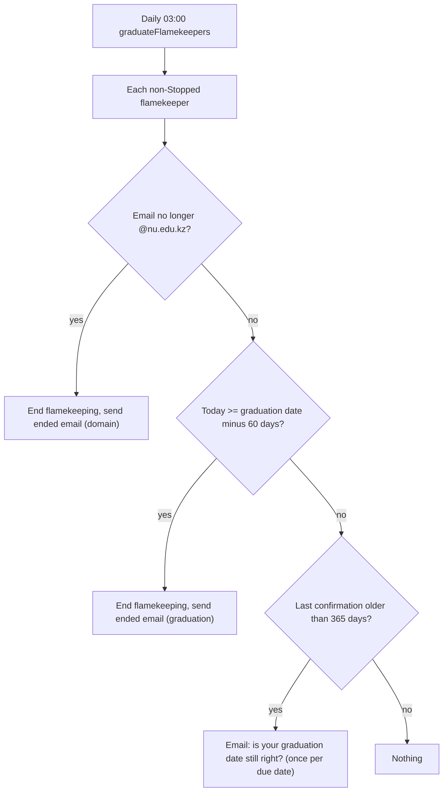
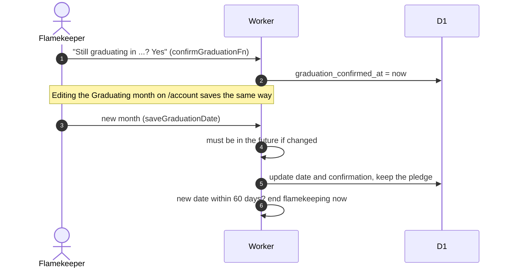

# Graduation date and automatic stop

Flamekeeping ends 60 days before the expected graduation month (the first day of the month is used).

## When does the app ask for confirmation and when does it stop?

At most 3 stops and 2 prompt emails per run, inside the step's budget; the rest wait for the next day.

## How does a flamekeeper confirm or change the date?

- Confirmation is due 365 days after the last confirmation (sign-up counts) and applies to Active, Full and Draining, not Lost or Stopped.
- Ending clears the grant exactly as in [stop.md](stop.md).
- The stop lead is the Settings value `graduationPromptDays` (default 60); the 365-day confirmation interval is a constant ([settings/other-settings.md](../../admin/settings/other-settings.md)).
