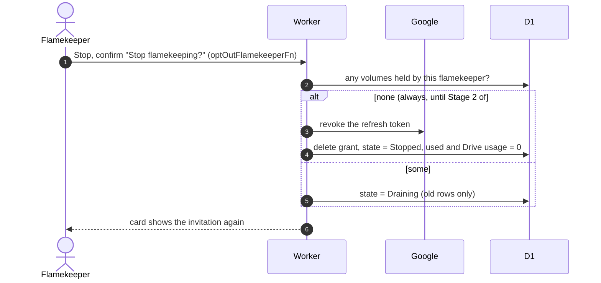

# Stop flamekeeping

## What happens when a flamekeeper stops?

- Ending is immediate and needs nothing more from the person; their files stay in their Drive.
- Stopping an already Stopped account is refused.
- The same end-of-flamekeeping runs on graduation, a non-`@nu.edu.kz` email and a ban ([graduation.md](graduation.md), [ADR-0020](../../../adr/0020-member-status-separate-from-flamekeeper-state-and-ban.md)).
- The master account's grant is never revoked at Google ([master-account](../../admin/flamekeepers/master-account.md)).
- A non-member with no active flamekeeping can then delete their account from `/account`; members keep it.
- To resume, sign up again ([become-flamekeeper](../onboarding/become-flamekeeper.md)).
