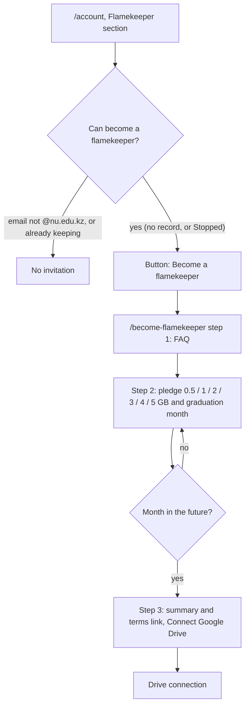

# Become a flamekeeper

An `@nu.edu.kz` user pledges reserve Drive space to the club ([Flamekeeper](../../../../GLOSSARY.md), [Pledge](../../../../GLOSSARY.md)). Membership is separate ([ADR-0011](../../../adr/0011-membership-and-flamekeeping-are-separate.md)), so members and non-members both use this flow.

## Who sees the invitation and what do they fill in?

- A Stopped flamekeeper (state `drained`) is treated as having no record and signs up again the same way.
- The club's master account is redirected to `/account` and cannot sign up ([master-account](../../admin/flamekeepers/master-account.md)).
- The graduation month is prefilled from the profile when set. It is stored as the first day of that month.

The connection itself, its errors and the callback are in [connect-drive.md](connect-drive.md). What the person sees afterwards is in [../account/account-card.md](../account/account-card.md).
