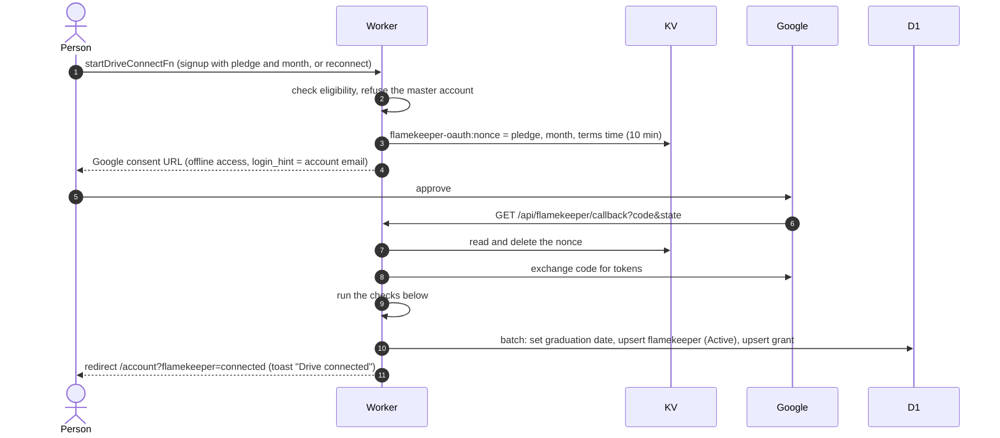
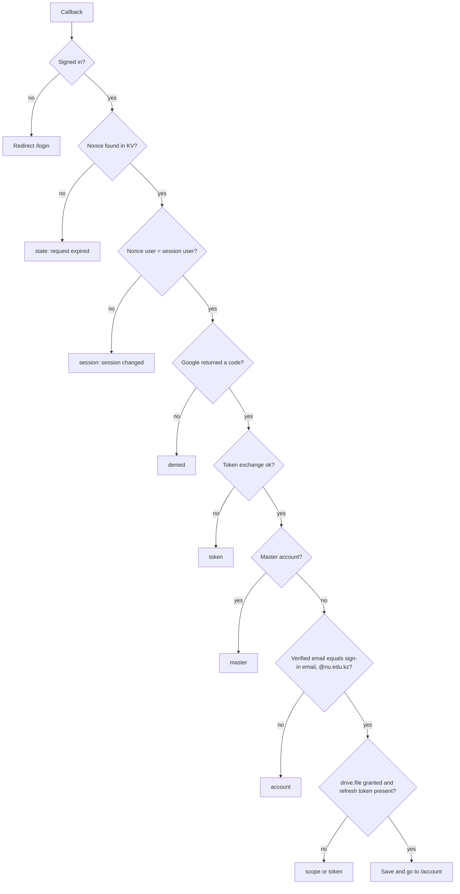

# Connect Drive and OAuth callback

Sign-up and reconnect both end in a Google consent for the `drive.file` scope (plus `openid` and `email`), so the app only sees files it creates ([ADR-0013](../../../adr/0013-drive-grant-stored-apart-from-login.md)). The grant is stored apart from the login in `flamekeeper_grant`.

## How does the Drive connection start and finish?

The nonce is single use. Signup requires `canBecomeFlamekeeper`, a valid pledge option and a future graduation month. Reconnect requires state Lost and reuses the stored pledge.

## What makes the callback fail?

Every error redirects to `/become-flamekeeper?fk_error=<code>`, which shows the message above the wizard. A reconnecting (Lost) flamekeeper is bounced on to `/account` with the same code, since they can no longer become one.

On a successful save the flamekeeper row is set Active and `lostSince`, `lostNotifiedAt` and `lostFinalizedAt` are cleared, so a reconnect brings a Lost flamekeeper back as if nothing happened. The row is created with `graduationConfirmedAt` set to now.
