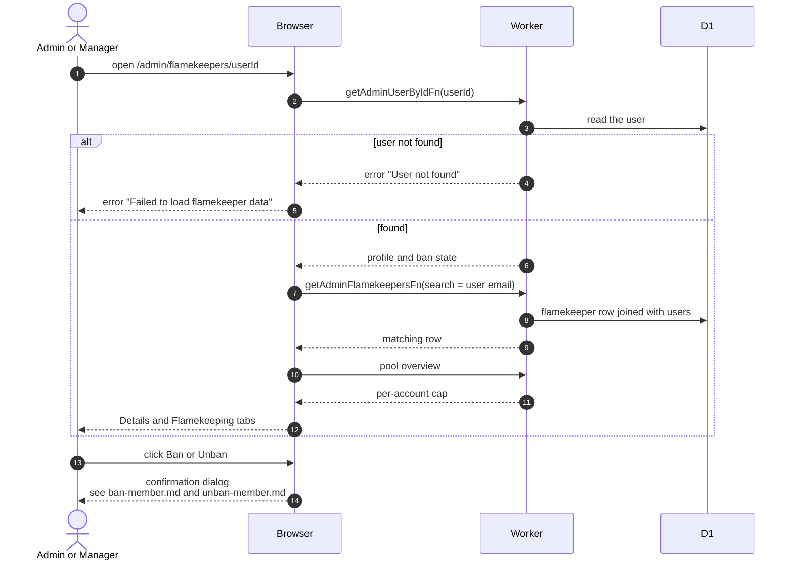

# Flamekeeper Detail Page

> **Question:** What does an admin or manager see on a flamekeeper's detail page?
>
> **Answer:** The page shows the person's profile fields on a Details tab and their flamekeeping record on a Flamekeeping tab. Admins also get a Ban or Unban button in the header, except on their own account. If the person has no flamekeeper record, the Flamekeeping tab says so.
>
> **Notes:**
>
> - Details shows name, email, user status, ban state and reason, Instagram, NU ID, birthday, major, graduation year, account age and user ID. Member-only fields such as role, clearance, albums and violation counters are not shown.
> - Flamekeeping shows the state, pledged, used and available space, Drive usage, the pool's per-account cap, graduation month, graduation confirmation, last health check, lost-since and reconnect deadline, and when flamekeeping started.
> - A person with an unknown id gets the error page "Failed to load flamekeeper data".
> - The Ban section is described in [../admin/ban-member.md](../admin/ban-member.md) and [../admin/unban-member.md](../admin/unban-member.md).
> - How flamekeepers are placed and checked is in [admin-pool.md](admin-pool.md) and [../cron/flamekeepers/health-probe.md](../cron/flamekeepers/health-probe.md).

