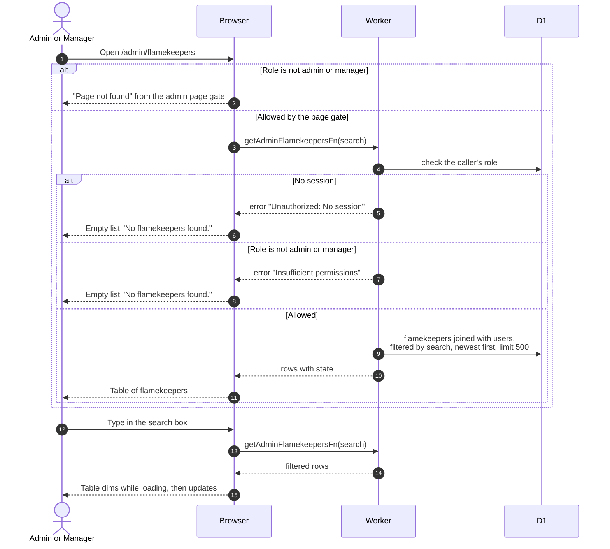

# Browse flamekeepers as an admin

> **Question:** What does an admin or manager see on the Flamekeepers page?
>
> **Answer:** The page lists every flamekeeper, newest signup first, with name, email, state, pledge, usage, and graduation date. Typing in the search box filters by name or email. Only admins and managers can open it. Admins also get a Ban button on each row except their own, and an Unban button on banned rows.
>
> **Notes:**
>
> - At most 500 rows are returned. The search text lives in the
>   address bar as ?search=. It matches the account name, first
>   name, last name and email.
> - Name shown is first and last name when set, otherwise the
>   account name. Member and Banned badges come from the user.
> - Managers and admins see the same list. Anyone else is stopped
>   earlier by the admin page gate and sees "Page not found", see
>   ../admin/route-gate.md. The server function also refuses them
>   with "Insufficient permissions" if called directly.
> - If the list fails to load, the page shows the empty-list text
>   "No flamekeepers found." and the error is only logged.
> - The Draining column and Move photos button were removed in
>   #24 (last `dev` commit containing them: `2565826`).
> - The Ban and Unban dialogs are described in
>   ../admin/ban-member.md and ../admin/unban-member.md.

