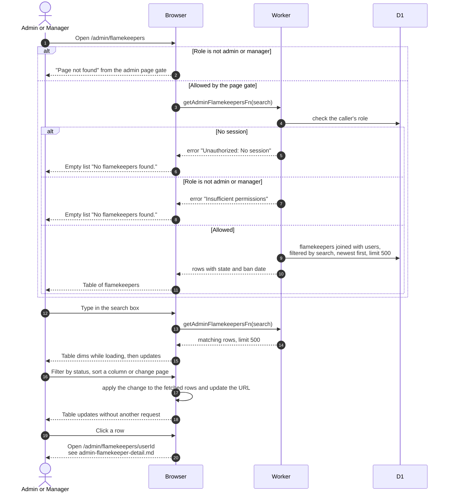

# Browse flamekeepers as an admin

> **Question:** What does an admin or manager see on the Flamekeepers page?
>
> **Answer:** The page lists every flamekeeper with name, email, a single read-only Status (Active, Full, Draining, Lost, Stopped or Banned), pledged space, used space and graduation date. Typing in the search box filters on the server by name or email. The status filter, column sorting and paging work in the browser over the fetched rows. Clicking a row opens that person's flamekeeper detail page. Admins get a Ban button on each row except their own and an Unban button on banned rows. Only admins and managers can open the page.
>
> **Notes:**
>
> - At most 500 rows are returned. The search text lives in the address bar as ?search=. It matches the account name, first name, last name and email.
> - The status filter, sort column, sort direction, page and page size also live in the address bar, but they are applied in the browser after the 500-row fetch. The default is newest first and 50 rows per page.
> - Status is read-only here. It is the flamekeeping state, or Banned when the person is banned. The member status (Active, Inactive, Alumni) is changed on the Club Members page, see [../admin/change-member.md](../admin/change-member.md).
> - Admins can tick rows (not their own, not already banned rows) and press Ban (N). The dialog asks for one reason and bans them all, with the toast "Banned N member(s)".
> - Name shown is first and last name when set, otherwise the account name. Member and Banned badges come from the user.
> - Managers and admins see the same list. Anyone else is stopped earlier by the admin page gate and sees "Page not found", see [../admin/route-gate.md](../admin/route-gate.md). The server function also refuses them with "Insufficient permissions" if called directly.
> - If the list fails to load, the page shows the empty-list text "No flamekeepers found." and the error is only logged.
> - The Draining column and Move photos button were removed in #24 (last `dev` commit containing them: `2565826`).
> - The Ban and Unban dialogs are described in [../admin/ban-member.md](../admin/ban-member.md) and [../admin/unban-member.md](../admin/unban-member.md).
> - The detail page is described in [admin-flamekeeper-detail.md](admin-flamekeeper-detail.md).

