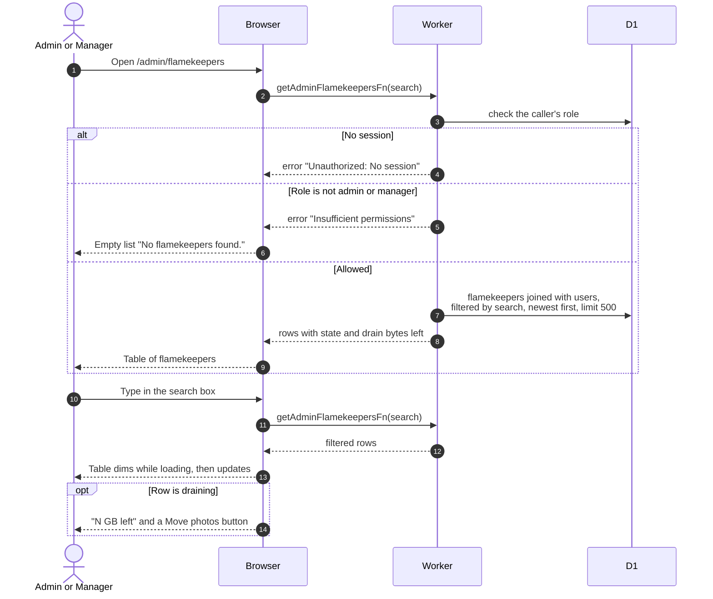

# Browse flamekeepers as an admin

> **Question:** What does an admin or manager see on the Flamekeepers tab of Manage Users?
>
> **Answer:** The page lists every flamekeeper, newest signup first, with name, email, state, pledge, usage, graduation date and, for draining flamekeepers, how much is left to move with a Move photos button. Typing in the search box filters by name or email. Only admins and managers can load it. Admins also see a Ban or Unban button on each row, except their own row.
>
> **Notes:**
> - At most 500 rows are returned. The search text lives in the
>   address bar as ?search=.
> - Name shown is first and last name when set, otherwise the
>   account name. Member and Banned badges come from the user.
> - The Move photos button opens the dialog described in
>   relay-hand-out.md and relay-move-photo.md.
> - Ban and Unban dialogs belong to the admin folder, see
>   ../admin/.
> - Managers and admins see the same list. A person with any other
>   role gets "Insufficient permissions".

