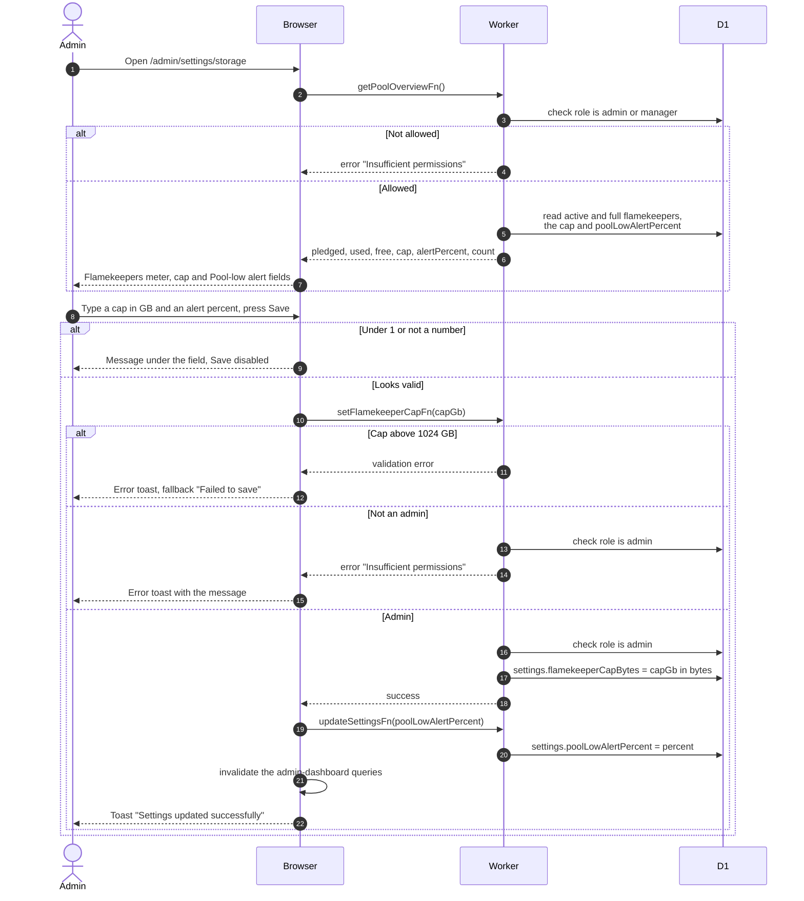

# See the pool and change the per-account cap

> **Question:** Where does an admin see the #savenuimg pool usage, and how does an admin change the cap and the Pool-low alert?
>
> **Answer:** The Storage tab of the admin dashboard (/admin/dashboard/storage) and the Storage tab of Settings (/admin/settings/storage) show the same usage summary (`src/components/shared/storage-usage.tsx`): a Buffer meter and a Flamekeepers meter, each with used of limit, a percent and an alert marker. The Flamekeepers meter shows used and pledged space, the percent used and how many flamekeepers are lending. New uploads no longer use the pool: they go to the buffer (../albums/upload-to-buffer.md). Admins and managers can see it. Only admins can change the per-account cap, the most of one Drive the app may use, and the Pool-low alert (% used), in the Flamekeepers section of Settings, Storage. One Save stores both, refreshes the dashboard queries and shows a toast "Settings updated successfully". The cap applies to later moves to flamekeepers.
>
> **Notes:**
> - Free space counts only active flamekeepers. For each one it
>   is the smaller of pledge left and cap left.
> - The meter turns to its alert style when the used share of the
>   pledged total reaches the Pool-low alert percent (default 90,
>   range 50 to 99), or when nothing is pledged. The Telegram
>   alert to admins is sent by the clock, see
>   ../cron/flamekeepers/pool-top-up.md. The alert marker on the
>   meter follows the percent typed in the form before saving.
> - The cap defaults to 20 GB. The browser checks 1 to 1024 GB.
> - Managers do not see the Flamekeepers section of the Storage
>   settings. Calling the function as a manager is refused with
>   "Insufficient permissions".
> - The cap does not move photos that are already stored.

