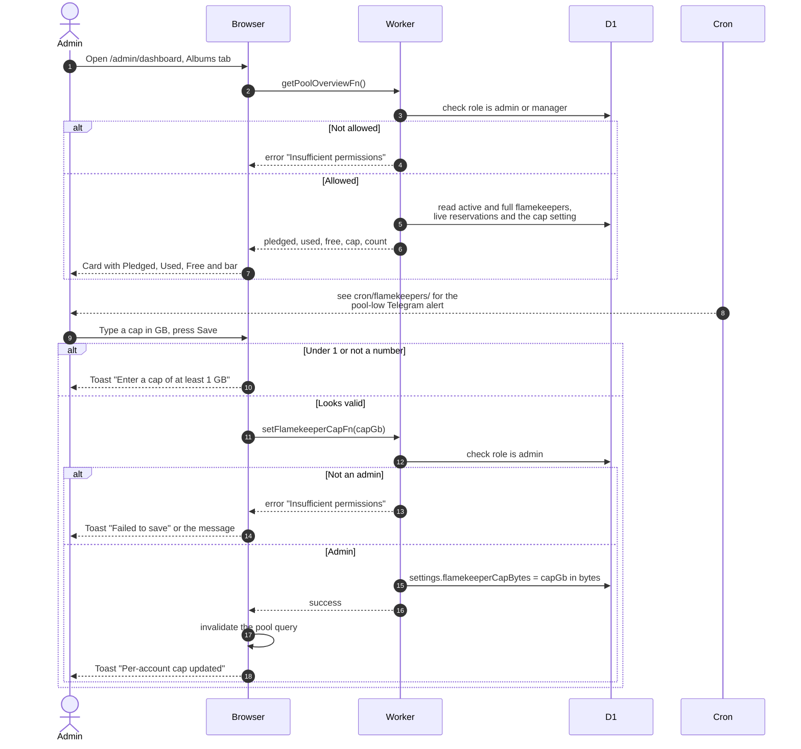

# See the pool and change the per-account cap

> **Question:** What does the #savenuimg pool card on the admin dashboard show, and how does an admin change the cap?
>
> **Answer:** The Albums tab of the admin dashboard shows how much space active and full flamekeepers pledged, how much is used, and how much is free to receive new photos. Admins and managers can see it. Only admins can change the per-account cap, the most of one Drive the app may use. Saving stores the new cap, refreshes the card and shows a toast. The cap applies to new placements from then on.
>
> **Notes:**
> - Free space counts only active flamekeepers. For each one it
>   is the smaller of pledge left and cap left, after subtracting
>   space reserved for uploads in progress.
> - The Free number turns red and admins get a Telegram alert when
>   free space drops under 10 percent of the pledged total, or
>   when nothing is pledged. The alert itself is sent by the clock,
>   see cron/flamekeepers/.
> - The cap defaults to 20 GB. It must be between 1 and 1024 GB.
> - Managers do not see the cap field. Calling the function as a
>   manager is refused as "Insufficient permissions".
> - The cap does not move photos that are already stored.

