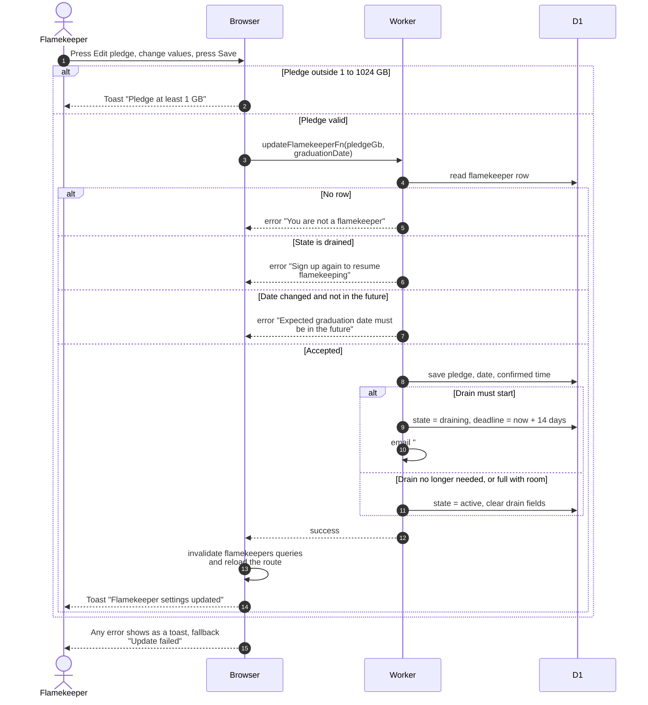

# Change the pledge or graduation date

> **Question:** What happens when a flamekeeper edits their pledge or expected graduation date?
>
> **Answer:** The edit dialog sends both values to the server, which saves them and works out whether the flamekeeper must start moving photos, may resume normal state, or can carry on unchanged. Lowering the pledge below what is already stored starts a 14-day drain of the excess. A graduation date under 60 days away starts a drain of everything. Raising the pledge above usage returns a full or pledge-draining flamekeeper to normal. The dialog closes with a toast and the profile refreshes.
>
> **Notes:**
> - The new values are always saved, even when a drain starts.
>   Saving also counts as confirming the graduation date.
> - When a drain starts, an email "#savenuimg: we are moving your
>   photos" is sent to the flamekeeper with the amount, the reason
>   and the deadline.
> - The server also rejects a pledge outside 1 to 1024 GB, with
>   the message "Pledge at least 1 GB" or "Pledge at most 1024 GB".
> - A drained flamekeeper cannot edit and must sign up again, see
>   connect-drive.md.
> - A graduation date that is unchanged is not re-checked for
>   being in the future.
> - After saving, profile data is reloaded, see profile-card.md.

