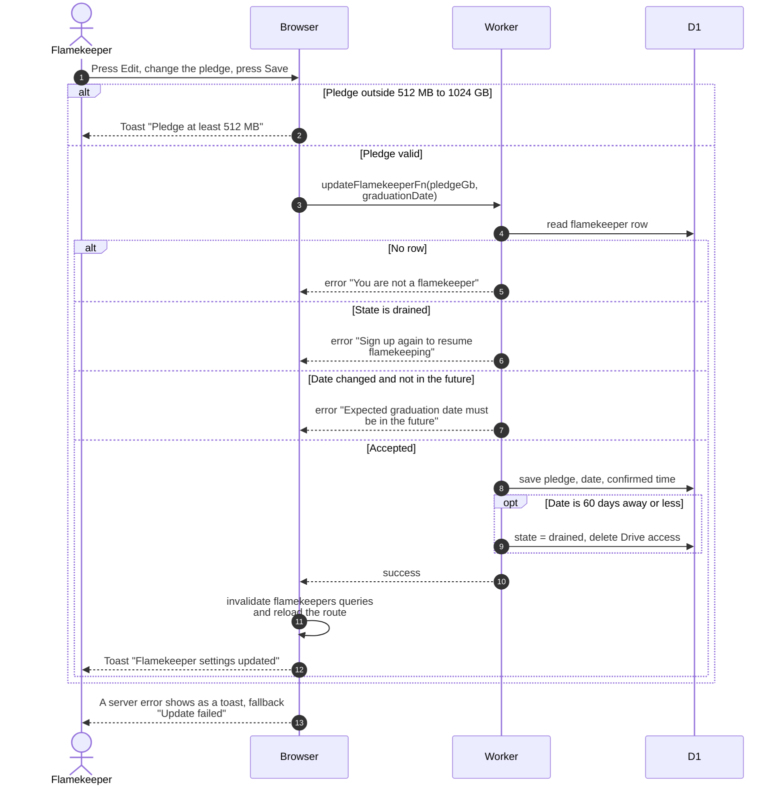

# Change the pledge or graduation date

> **Question:** What happens when a flamekeeper edits their pledge or expected graduation month?
>
> **Answer:** The Edit button on the pledge row opens a dialog for the pledge. It sends the pledge and the graduation month already stored to the server (the month itself is changed in the Graduating field, see ../account/profile-edit.md), which saves them. A graduation date under 60 days away ends flamekeeping at once (Drive access deleted, state drained), because nothing is held on a flamekeeper. The pledge never causes anything to move. The dialog closes with a toast and the profile refreshes.
>
> **Notes:**
> - The new values are always saved, even when flamekeeping ends.
>   Saving also counts as confirming the graduation date.
> - The old pledge-below-usage drain and graduation drain were
>   removed in #24 (last `dev` commit containing them:
>   `2565826`).
> - The server also rejects a pledge outside 512 MB to 1024 GB, with
>   the message "Pledge at least 512 MB" or "Pledge at most 1024 GB".
> - A drained flamekeeper cannot edit and must sign up again, see
>   connect-drive.md. A lost flamekeeper can still edit.
> - The date is stored once, on the user, not on the flamekeeper. Changing it in the Graduating field follows the same 60-day rule as this dialog.
> - A graduation date that is unchanged is not re-checked for
>   being in the future.
> - After saving, profile data is reloaded, see profile-card.md.

