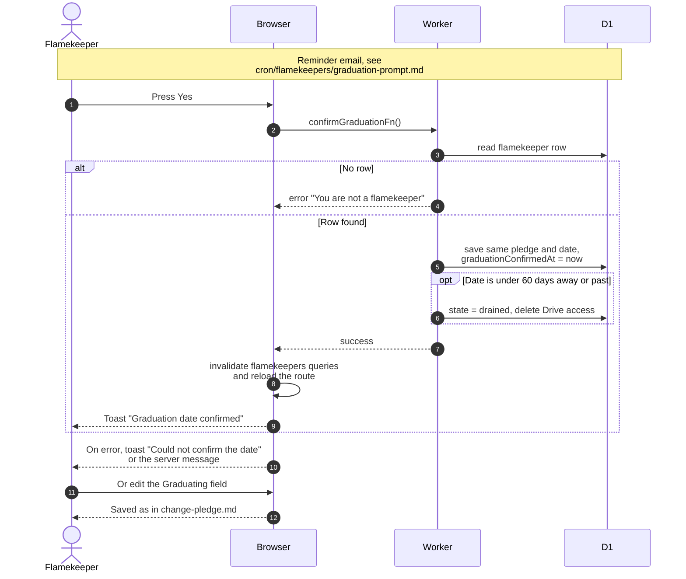

# Confirm the graduation date

> **Question:** What happens when a flamekeeper answers the yearly "is this still your graduation date?" question?
>
> **Answer:** Pressing Yes on the "Still graduating in ..." row saves the same pledge and date again and records the confirmation time, which starts a new 365-day wait. To change the date instead, the flamekeeper edits the Graduating field. If the confirmed date is already under 60 days away (or past), the same save also ends flamekeeping at once.
>
> **Notes:**
> - The question appears on the profile card once 365 days have
>   passed since the last confirmation (or since signing up if
>   there was none). It never appears for drained or lost
>   flamekeepers.
> - A reminder email for the same question is sent by the clock,
>   see ../cron/flamekeepers/graduation-prompt.md.
> - Confirming sends the date stored in the row. A new date can
>   also be passed, but the button on the card does not send one.
> - Editing the Graduating field is the same flow as change-pledge.md.
> - The server only needs a flamekeeper row, so the call also
>   works in any state, including a leftover draining state.

