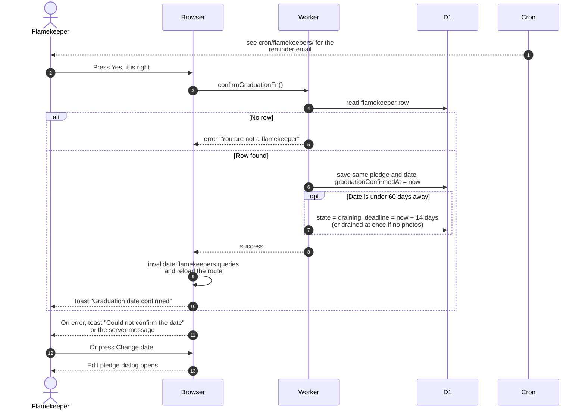

# Confirm the graduation date

> **Question:** What happens when a flamekeeper answers the yearly "is this still your graduation date?" question?
>
> **Answer:** Pressing "Yes, it is right" saves the same pledge and date again and records the confirmation time, which starts a new 365-day wait. Pressing "Change date" opens the edit dialog instead. If the confirmed date is already under 60 days away, the same save that confirms it also starts the drain of all photos.
>
> **Notes:**
> - The question appears on the profile card once 365 days have
>   passed since the last confirmation (or since signing up if
>   there was none). It never appears for drained or lost
>   flamekeepers.
> - A reminder email for the same question is sent by the clock,
>   see cron/flamekeepers/ for when and how often.
> - Confirming sends the date stored in the row. A new date can
>   also be passed, but the button on the card does not send one.
> - Change date is the same flow as change-pledge.md.
> - The server only needs a signed-in flamekeeper row, so the call
>   also works for a draining flamekeeper.

