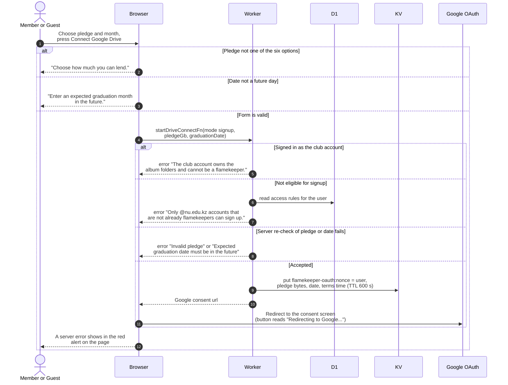

# Sign up as a flamekeeper and connect a Drive

> **Question:** What happens when someone fills in the Become a flamekeeper page and presses Connect Google Drive?
>
> **Answer:** The page at `/become-flamekeeper` has three steps: plain answers, the pledge and graduation month, then Connect. Only @nu.edu.kz accounts that are not flamekeeping (and not the club account) can open it; anyone else is sent to `/profile`. The pledge is one of six buttons (512 MB, 1 GB selected, 2 to 5 GB) and the graduation month comes from a month and year input, prefilled from the saved one. On Connect the browser asks the server to start the connection. The server refuses the club account and anyone who cannot sign up, remembers the pledge for 10 minutes under a random code and returns a Google consent link, and the browser goes to Google. There is no terms box: the page says connecting means agreeing to the terms, with one link to the Terms of Service.
>
> **Notes:**
> - The pledge is only stored in KV at this point. No flamekeeper
>   row exists until Google comes back, see drive-callback.md.
> - The pledge must be one of 512 MB, 1, 2, 3, 4 or 5 GB. The graduation date is
>   stored as the first of the chosen month (`YYYY-MM-01`) and must
>   be after now, so the current month is refused.
> - Reconnecting a lost flamekeeper uses the same function in
>   reconnect mode, see profile-card.md.
> - Google is asked for the drive.file, openid and email scopes,
>   with offline access and a forced consent screen. The sign-in
>   email is passed as a login hint.
> - Why the club account is refused is in master-account.md.
> - The profile card, the About button, the low-space banner and a
>   one-time invitation all link here. The invitation is a dialog
>   shown once to @nu.edu.kz users who have never had a flamekeeper
>   record; either button stores `user.flamekeeper_invitation_dismissed_at`
>   so it stays gone on every device.
> - A drained flamekeeper opens the same page.

