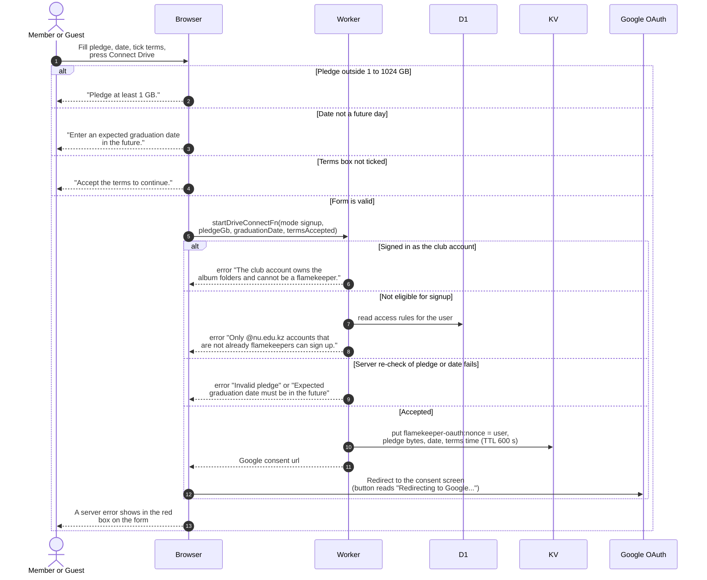

# Sign up as a flamekeeper and connect a Drive

> **Question:** What happens when someone fills in the flamekeeper form and presses Connect Drive?
>
> **Answer:** The browser checks the pledge, the graduation date and the terms box, then asks the server to start the connection. The server refuses the club account and anyone who cannot sign up (not an @nu.edu.kz account, or already flamekeeping). Otherwise it remembers the pledge for 10 minutes under a random code and returns a Google consent link, and the browser goes to Google. The form is on the onboarding page for new @nu.edu.kz sign-ups and in the profile card for @nu.edu.kz accounts that are not flamekeeping.
>
> **Notes:**
> - The pledge is only stored in KV at this point. No flamekeeper
>   row exists until Google comes back, see drive-callback.md.
> - Pledge limits are 1 GB to 1024 GB. The date must be a real
>   calendar day after now (UTC midnight), so today is refused.
> - Reconnecting a lost flamekeeper uses the same function in
>   reconnect mode, see profile-card.md.
> - Google is asked for the drive.file, openid and email scopes,
>   with offline access and a forced consent screen. The sign-in
>   email is passed as a login hint.
> - Why the club account is refused is in master-account.md.
> - A drained flamekeeper sees the form behind a Become a
>   flamekeeper switch on the profile card.

