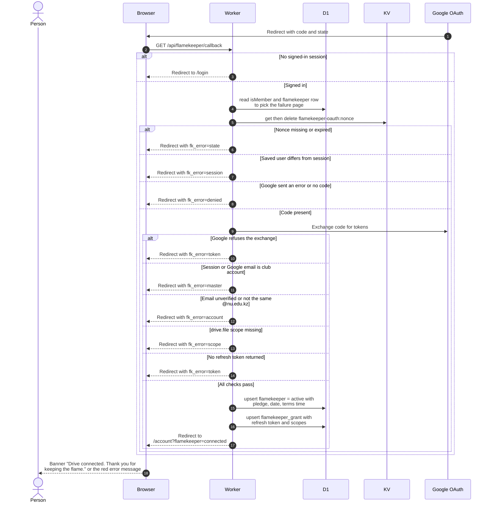

# Come back from Google after connecting a Drive

> **Question:** What happens when Google sends the person back to the app, and what does each error mean?
>
> **Answer:** The callback checks the person is signed in, finds the pledge saved before the redirect, trades the Google code for tokens and checks that the Drive belongs to the same @nu.edu.kz account, has file access and gave a refresh token. If everything is fine it creates (or revives) the flamekeeper as active, saves the refresh token, and sends the person to the profile page with a "Drive connected" banner. Any failure sends them back with an error code that shows as a red message on the form.
>
> **Notes:**
>
> - Failures go back to /become-flamekeeper, which sends anyone who
>   cannot use it on to /account with the same code. The code travels in the address as
>   fk_error.
> - The saved pledge is deleted as soon as it is read, so
>   refreshing the callback gives the "state" error.
> - Messages by code. denied: "Google access was not granted. You
>   can try again." state: "The connection request expired.
>   Please start again." session: "Your session changed during
>   the connection. Please start again." account: "Connect Drive
>   with the same @nu.edu.kz Google account you signed in with."
>   scope: "The Drive permission was not granted. Please allow
>   file access." token: "Google did not return a usable
>   authorization. Please try again." master: "The club account
>   owns the album folders and cannot be a flamekeeper."
> - A returning flamekeeper (drained or lost) is set back to
>   active with the new pledge, date and terms time. The deadline
>   and lost markers are cleared. Used bytes are left as they were, and the graduation confirmation time is
>   only set for a brand new row.
> - The code is exchanged on the server with the client secret.
>   The cached access token for this user is dropped afterwards.

