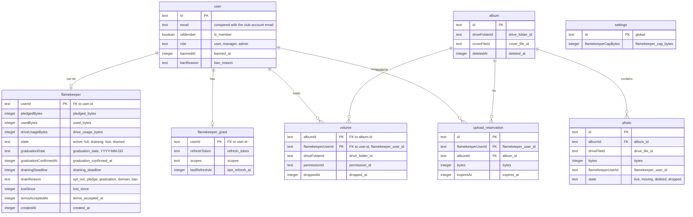

# Flamekeeper data

> **Question:** Which tables do the flamekeeper scenarios read and write?
>
> **Answer:** A flamekeeper has one row with pledge, usage and state, one saved Google refresh token, one folder (volume) per album it holds photos for, and temporary upload reservations while photos are in flight. Photos point at the flamekeeper that stores them. The cap lives in the global settings row.
>
> **Notes:**
> - KV key flamekeeper-oauth:nonce holds user id, pledged bytes,
>   graduation date and terms time as JSON, for 600 seconds. It is
>   deleted when read, see connect-drive.md and drive-callback.md.
> - R2 is not used by these scenarios.
> - Reservations expire 2 hours after they are made.
> - Used and pledged sizes are in bytes. The default cap is
>   21474836480 bytes (20 GB).
> - The access token cache lives in Worker memory for 50 minutes
>   and is not stored anywhere.

