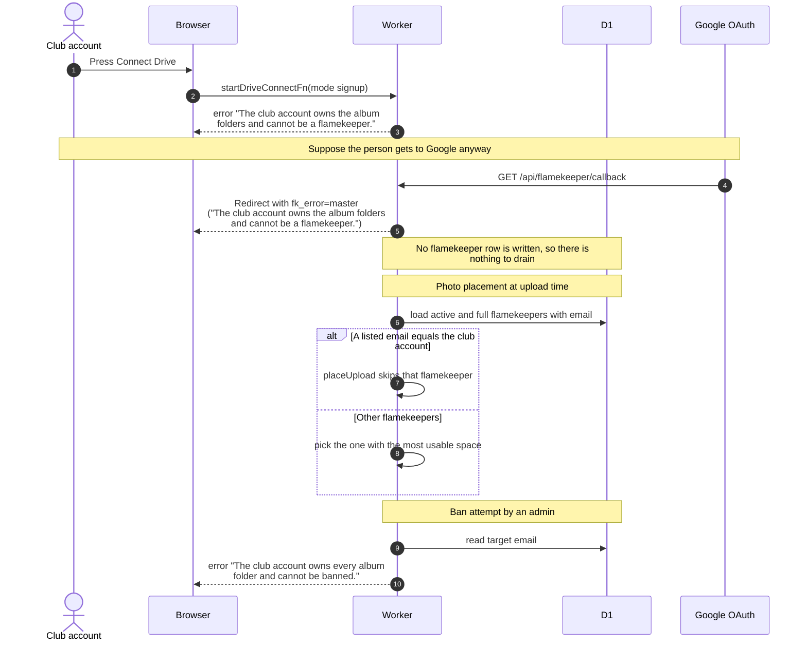

# Keep the club account out of the pool

> **Question:** What stops the club account (nu_image, the master account) from holding uploads or being drained?
>
> **Answer:** The club account owns every album folder, so it must never become a flamekeeper. It is refused at three points: when it starts the Drive connection, when Google returns (if either the signed-in email or the Google email matches it), and whenever the app picks a flamekeeper to receive a photo, where it is skipped even if a row somehow exists. It also cannot be banned, since a ban starts a drain. Because it never gets a flamekeeper row, it can never be draining.
>
> **Notes:**
> - The club account is identified by comparing the email, ignoring
>   case and spaces, with the GOOGLE_MASTER_EMAIL setting. If the
>   setting is empty nobody is treated as the club account.
> - When a grant is dropped at the end of a drain, the app does not
>   revoke it at Google if it belongs to the club account, so the
>   master login cannot be cut off by accident.
> - Messages. Start: "The club account owns the album folders and
>   cannot be a flamekeeper." Ban: "The club account owns every
>   album folder and cannot be banned."
> - The ban refusal is part of the admin ban flow, see
>   ../admin/ban-member.md for the dialog itself.
> - The Google return check only happens after Google has handed
>   back tokens, so a failed token exchange shows the token error
>   first.
> - Non-members are never sent to onboarding, so the club account
>   is not sent to any sign-up page.
> - Normal connection steps are in connect-drive.md and
>   drive-callback.md.

