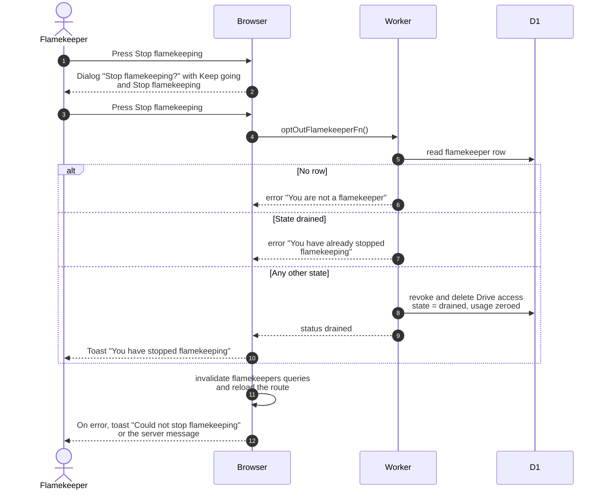

# Stop flamekeeping

> **Question:** What happens when a flamekeeper presses Stop flamekeeping?
>
> **Answer:** A confirmation dialog says that flamekeeping ends right away and that the app removes its access to the Drive. After confirming, the flamekeeper becomes drained straight away: usage is zeroed and the stored Drive access is revoked at Google and deleted. Nothing is held on a flamekeeper's Drive, so there is nothing to move and no deadline. Someone who already stopped is refused.
>
> **Notes:**
> - The same ending applies to graduation, a changed email domain and a ban, see ../cron/flamekeepers/graduation-trigger.md and ../admin/ban-member.md. None of them send photos anywhere.
> - The state name `drained` is kept for "stopped". The old draining state, 14-day deadline, reminders and browser relay were removed in #24. The last `dev` commit that still contains them is `2565826`; see [ADR-0009](../../adr/0009-drive-file-only-photos-move-through-browser.md).
> - A flamekeeper left in the old `draining` state by earlier code is ended by the hourly `drainFlamekeepers` step, see ../cron/flamekeepers/steps-and-limits.md.
> - Only active or full flamekeepers see the button. A lost flamekeeper reconnects first, see connect-drive.md.
> - A drained person can sign up again, see connect-drive.md.

