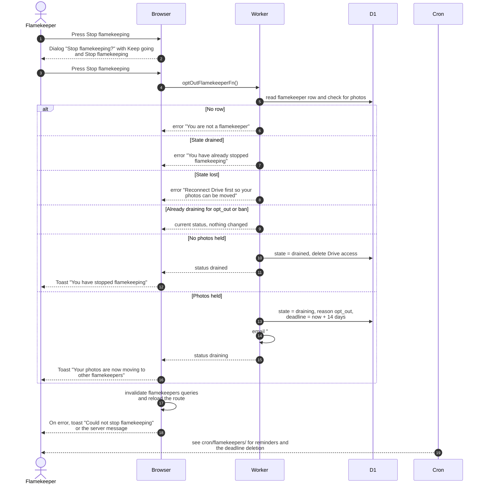

# Stop flamekeeping

> **Question:** What happens when a flamekeeper presses Stop flamekeeping?
>
> **Answer:** A confirmation dialog explains that new uploads stop at once and that photos not moved within 14 days are deleted. After confirming, a flamekeeper holding no photos becomes drained straight away and the app deletes its Drive access. One who holds photos goes into a 14-day draining state, receives an email, and moves the photos through the browser. A lost flamekeeper or one already drained is refused.
>
> **Notes:**
> - Draining ends when the last photo has moved. Then the state
>   becomes drained, usage is zeroed, and the stored Drive access
>   is revoked at Google and deleted.
> - Becoming drained also needs the person's empty album folders
>   released and no upload in flight. If that cannot finish yet,
>   the state is unchanged and the second toast is shown.
> - Already draining for opt_out or ban: pressing again changes
>   nothing and returns the current status. Draining for another
>   reason is switched to an opt_out drain with a fresh 14-day
>   deadline.
> - The moving itself is in relay-hand-out.md. The deadline and
>   reminders are handled by the clock, see cron/flamekeepers/.
> - The email says "Open your account page and keep the tab open
>   while the photos move. An admin may also move them for you."
> - A drained person can sign up again, see connect-drive.md.

